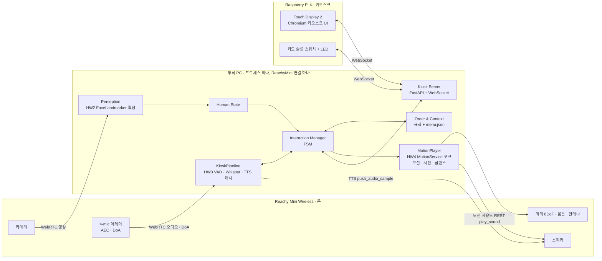
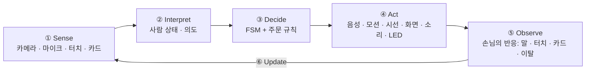
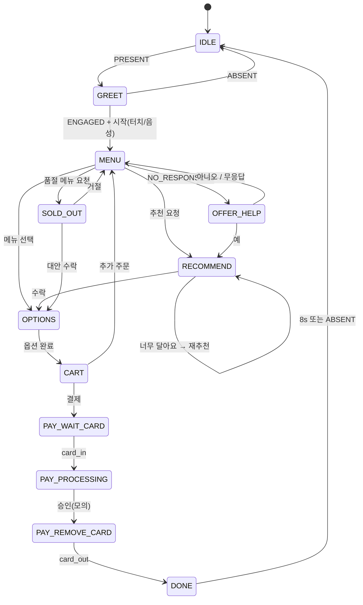

# Reachy Café — 구현 계획서

> 작성 2026-11-23(월) · 기준 자료: `Proposal_HRI.pptx`(Team 3 제안서 7장), 교수님 텀프로젝트 공지, **상위 폴더의 HW2·HW3·HW4 코드 분석 결과**
> **최종 발표 12/1(화) = D-8 (확정)** · 보고서·코드·영상·피어평가 마감 12/11(금) 23:59

### 진행 상황 (11/24)

- **1단계 완료 · 로봇 없이 끝까지 도는 키오스크**: 주문 FSM(상태 12개 + 오버레이 3개), 규칙 기반 NLU(한/영), 추천·문장 템플릿, 사람 상태 추정 6종, 행동 타이밍(HW4 모션 라벨 동기화, mock 로봇), 키오스크 UI(720×1280, 한/영, 상태 스트립), 오퍼레이터 패널 겸 시뮬레이터, Pi 4 카드 슬롯 에이전트·설치 스크립트. 테스트 62개 통과, 브라우저에서 S1·S2·S3와 실패 오버레이 확인. 실행 방법은 [README.md](README.md).
- **2단계 코드 완료 (11/24) · 실제 로봇 검증 대기**: `reachy_cafe/robot/`
  - 공유 연결 `RobotLink`: 워블링·헤드트래킹 끄기 → 모터 켜기 → wake_up (HW4 SdkBackend·HW3 RobotSink 순서)
  - `MotionPlayer` (HW4 `MotionService` 상속): 50 Hz 시선 레이어(손님·화면·슬롯·둘러보기) + 자세·끄덕임·안테나 오프셋, head 트랙 라벨 이벤트(화면·음성 동기화), YAML 효과음 큐(RobotSpeaker), PreparedMotion 캐시, HW4 정책보다 안쪽으로 시선 범위 제한
  - `KioskSpeech` (HW3 A1에서 LLM 제외): AudioManager·Silero VAD·BargeInDetector·Whisper·Supertonic, TTS 디스크 캐시와 고정 문장 미리 합성, 예/아니요 끝점 500 ms, Whisper 환각 문장 필터, 메뉴 이름을 initial_prompt로
  - `FacePerception` (HW2 FaceLandmarker 확장): 3명, IoU 추적 id, yaw·pitch, 주 손님 눈높이 → 촬영 순간 머리 자세 기준 월드 방향 → 시선 목표
  - `RealRobot`: 채널별 부분 실패 폴백(카메라 → 얼굴 프리셋, 음성 → 화면·텍스트, 모션 → 음성·화면), 연결 실패 시 mock 전환
  - 연결 점검 `tools/spike_connection.py` (5.1 체크리스트 + 주의 방향 보정 `--calibrate`). 테스트 105개 통과 (실제 로봇 모듈 26개는 HW4 MockBackend·HW3 MockAudioBackend·가짜 ASR/TTS/VAD로 실제 시간에)
- **11/24 MuJoCo 시뮬 점검 (`tools/sim_check.py`, HW4 sim daemon + 실제 SDK 경로)**: 6단계 모두 통과 (`logs/sim_check_20261124_145415.json`). 시선 방향 오차 0.1–0.7°, 자동 몸통 회전 0°, 감정 모션 8개 완료·틱 지연 0·라벨 = YAML 시각 + 0.1 s, 선점 시 한 틱 최대 3.4°, 종료 후 REST 오차 0.15°, 측정 관절 여유 최소 13.7°(정책 10°)·관절 속도 p99 91°/s(정책 309°/s). 키오스크 앱 전체도 시뮬 로봇에 붙여(`config/sim.toml`) S2·S3를 끝까지 돌림. 점검에서 찾아 고친 것:
  1. 시선 극단(카드 슬롯 쪽 좌 45°·아래 25°)에 끄덕임·perk_up이 더해지면 Stewart 관절 여유가 HW4 정책(10°) 밑으로 → `JointGuard`: daemon과 같은 IK·URDF 한계로 매 틱 검사하고 부족하면 정면 쪽으로 줄임. 여유가 11°일 때 시뮬 추종 오차 3.7°(가장자리에서 관절이 끝까지 못 감) → 하한을 14°로
  2. 종료 시 REST로 보낸 뒤 시선 레이어가 다시 화면 쪽으로 끌어감 → `MotionPlayer.park()` (RealRobot.close에서 사용)
  3. 슬롯을 보던 자세에서 Success까지 HW4 기본 전이(60°/s)로 1.68 s → 결제 완료 화면이 2.5 s 늦음 → 전이 상한 150°/s·최소 0.3 s (0.68 s, 화면 1.75 s). 빨라진 전이 40개 조합도 HW4 검사 통과
  4. media 없이 연결되면 카메라가 프레임 없이 "ok"로 보임 → 시작할 때 첫 프레임 확인, 없으면 얼굴 프리셋으로 폴백
  - 시뮬은 실제 로봇보다 추종이 느려(시간 상수 약 0.7 s, HW4 실측 로봇 지연 약 0.19 s) 지연 값은 실제 로봇에서 다시 잰다
- **11/24 데스크톱 점검 준비**: 순서는 [docs/desktop_check.md](docs/desktop_check.md) (설치 → 사전 점검 → 연결 점검 → 배치 보정 → 실행 → 결과 보내기)
  - `tools/preflight.py`: 로봇을 움직이지 않고 패키지·GPU·HW 파일·모델(`--load-models`면 Whisper GPU·Supertonic·MediaPipe 실제 실행)·네트워크(로봇과 같은 대역인지)·daemon 버전·미디어·IK 엔진 확인
  - `tools/make_bundle.py`: 키오스크 + 필요한 HW3·HW4 코드 + 얼굴 모델 묶음 (가상환경·로그·비밀·보정 파일 제외, 풀면 [hw] 상대 경로가 그대로 맞음)
  - `tools/spike_connection.py --aim --calibrate`: 화면·슬롯 위치를 로봇 시선으로 맞추고, 고개 방향 부호·임계값과 실측 라벨 지연을 `config/calibration.toml`에 저장 (`--config config/calibration.toml`로 실행)
  - 시뮬 리허설에서 발견·수정: 미디어 없는 daemon에 효과음을 올리면 400이 나고 시뮬 daemon은 오류 없이 죽었다 → 올리기 전에 `/api/media/status`의 available 확인. 연결이 끊긴 채 보정이 "통과"로 끝나지 않게 상태 수신 확인
- **11/24 Windows·macOS·Linux 세 버전**: OS별 시작 스크립트 `start_windows.bat`·`start_mac.command`·`start_linux.sh` (번호 메뉴 / 명령 setup preflight spike calibrate kiosk mock sim test), OS별 묶음(`make_bundle.py`: windows·mac zip, linux tar.gz, 실행 권한·줄바꿈 맞춤), 안내서 [docs/desktop_check.md](docs/desktop_check.md) OS별 명령
  - uv로 OS별 의존성 확인: Windows x64·Linux x86_64/aarch64·macOS 14+ Apple Silicon 가능, **Intel 맥·macOS 13 이하 불가** (mediapipe 1.0.1·onnxruntime 1.27.0 패키지 없음)
  - 리눅스는 GStreamer가 pip에 없다 (reachy-mini가 Windows·맥만 gstreamer-bundle): 시스템 GStreamer 1.22+ + PyGObject 소스 빌드 + Rust webrtc 플러그인(`webrtcsrc`, SDK WebRTC 클라이언트가 씀) → `scripts/linux_gstreamer_webrtc.sh` (Seeed Studio 안내 순서), 시작 스크립트가 `GST_PLUGIN_PATH`·CUDA `LD_LIBRARY_PATH`를 잡음
  - 음성 인식: CUDA GPU가 없으면 자동으로 CPU int8 (맥·GPU 없는 PC), GPU 로딩이 실패하면 CPU로 다시 시도 (데모 중 실패 처리). 사전 점검은 OS 조건과 GStreamer WebRTC 요소를 실제로 검사
  - 검증: Windows는 배치 메뉴·명령·묶음 처음부터 설치, 리눅스는 WSL Ubuntu 22.04에서 스크립트 검사 경로와 묶음(권한·배치), 맥은 문법 검사와 명령 분기만 (맥 실기 미확인)
- **11/24 보완 기능 추가 (기능 플래그로 넣었고, 테스트 후 유지/제외 결정)**: 호객·접근 의도, 주의 방향(로봇/화면/딴 곳)과 도움 요청 판단, 백채널(끄덕임·터치 쪽 힐끗), 메뉴 설명("아인슈페너가 뭐예요?"), 날씨·시간대 인사, 청중용 "Reachy의 생각" 화면(`/stage`), 평가 기록·로그 분석 도구. 5.11절과 [docs/evaluation_protocol.md](docs/evaluation_protocol.md) 참고. 테스트 79개 통과.
- **11/25 손님 인사 모션 (greeting)**: 손님이 다가오면(GREET) 고개 숙여 인사하는 모션과 함께 "안녕하세요! 주문 도와드릴까요?". 인사말과 환영 화면은 고개를 숙이기 시작하는 `bow` 키프레임에 맞춤(`[motion.sync_labels] greeting = "bow"`). 이전에는 안테나 흔들기 제스처 + 바로 인사말이었다.
  - 모션 파일: `motions/greeting.expressive.yaml`(2.75 s: 알아챔 → 숙여 인사 0.35 s 유지 → 올려다보며 오른쪽 안테나로 손 흔들기 → 복귀, 소리 없음) · `greeting.neutral.yaml`(1.9 s 직선 인사). **초안(`draft: true`)**: 각도·시간·의도 설명은 팀이 로봇에서 보고 정한 뒤 `draft: false`로 확정
  - HW4 폴더는 그대로: `reachy_cafe/robot/motion_library.py`가 HW4 모션 + 카페 모션을 합치고 HW4 이름 검사에 `greeting`만 더함 (5.7절)
  - 한 손님에게 한 번만: 대기 화면을 먼저 누르거나 언어를 고르면 메뉴 화면은 바로 띄우고 인사말(`greet_menu`)만 bow에 맞춤(`Act.screen_first`), 손님이 먼저 "안녕하세요"라고 하면 인사 모션과 함께 답함, 인사 뒤 언어를 바꿔도 다시 절하지 않음, 주문부터 말하면 인사 없이 바로 답함
  - 확인: HW4 안전 검사 통과(관절 여유 최소 33.6°/32.7°, 기준 10°), mock 시간표 = YAML(모션 5개 × 2변형 비교 테스트), MuJoCo 시뮬 6단계 통과(`logs/sim_check_20261125_223915.json`: 인사 모션 2변형 완료·틱 지연 0·라벨 = YAML + 0.1 s·끝 자세 오차 0.18°/0.4°), mock 앱에서 다가옴 → 0.42 s에 bow와 함께 인사말. 테스트 124개 통과. 실제 로봇에서는 인사 크기·속도와 인사말이 고개 드는 순간과 겹치는지 볼 것
  - 시뮬 영상: `tools/greeting_video.py` (HW4 `sim_video` 오프라인 재생 + 한국어 자막, HW4 가상환경으로 실행) → `results/videos/greeting_views.mp4`(정면·45°, 실제 속도 + 0.5×)·`greeting_vs_neutral.mp4`. 시뮬은 명령을 최대 8.5° 늦게 따라가므로 실제 로봇보다 인사가 작게 보일 수 있음. YAML을 고친 뒤 다시 실행
- **11/25 상태 스트립 '계획' 줄 고침**: 계획을 정하지 않은 액트(되묻기·재질문·창 닫기·호객 끝)가 나가면 앞 액트의 계획이 남았다 (예: 메뉴 설명 뒤 후보 창에서도 "메뉴 설명: 아인슈페너", 언어를 바꿔도 한국어 그대로). 이제 FSM `_act`가 모든 액트에 지금 상태·오버레이의 계획을 붙이고(되묻기·호객은 한 번만 보이고 상태 계획으로 복귀), BehaviorManager가 언어를 바꾸면 계획 줄을 새 언어로 다시 쓴다. 테스트 131개 통과, mock 앱에서 같은 장면 확인.
- **11/26 전체 검토와 수정 (데모·평가 전에 꼭 고칠 15건)**: 코드를 세 영역(대화·FSM / 실행·서버·화면·평가 로그 / 실제 로봇 경로)으로 나눠 독립 검토하고, 데모 시나리오·평가 과제를 직접 돌려 재현한 문제를 고쳤다.
  - 결제: 카드를 넣을 차례에는 일시정지까지 20 s(`[timing] pay_pause_after_absent_s`, 지갑을 찾느라 얼굴이 안 보여도 멈추지 않게), 일시정지 중 카드를 넣으면 풀고 바로 결제, 미리 꽂아 둔 카드로 결제, 승인 뒤에는 "취소" 무시 (예전: 결제하고도 60 s 뒤 주문 취소, 카드가 꽂힌 채 주문 삭제)
  - 음성 이해: 두 글자 별칭은 단어 안에서만(말 앞 "아"가 아이스 아메리카노가 되던 문제), 예/아니오는 첫 단어·부정 표현을 먼저("No, that's not right"·"안 맞아요"가 결제 승인되던 문제, "please" 단독 제외), "너무 달지 않은·not too sweet·커피가 아닌 것"은 취향(평가 과제 T2 첫 문장), "이어서·계속·continue"는 이어 가기, "안녕하세요·hello" 인텐트
  - 소음: 아무도 안 보일 때 알아들을 수 없는 말은 버리고(`speech.ignored`), 말소리(VAD)는 주문 중에만 손님이 있다는 근거로 씀 (예전: 관객 잡담에 빈 자리로 인사·끄덕임). 일시정지 중 잡담으로 이어 가지 않음
  - 행동: 어떻게 시작하든 세션이 시작되면 지루함 모션 끔, 키프레임 전에 끊긴 액트의 화면도 띄움(Aha! 도중 되묻기), 리셋·손님이 떠나면 하던 말을 끊음(작별 인사는 세션 언어로, `Act.lang`), 조건 A에서는 고개 자세도 끄고 정면에 멈춤 (with/without 비교 오염 방지)
  - 평가 집계(`tools/analyze_logs.py`): 조건은 실제로 켜진 기능으로(기록 칸 값과 다르면 `condition_mismatch`), 오퍼레이터 개입 수 `assisted`(패널 미리보기 터치는 `source: preview`로 구분), 지연을 `median_asr_s`·`median_reply_s`로 나눔, 품절·되묻기 회복 시간(H2), 결제 전 카드 투입 수, 세션을 시작한 첫 입력·마지막 언어 반영, 대기로 돌아가면 세션 종료
  - 로봇 첫 연결: 얼굴 추적·흔들기를 끄기 전에 목표를 지금 자세로 맞춤(머리 목표가 없는 daemon에서는 끄는 명령의 IK가 정면이라 토크가 켜져 있으면 고개가 튐: MuJoCo 시뮬 잠든 자세에서 22.7° → 고친 뒤 1.6°), 토크가 꺼져 있으면 한 번 더 맞춘 뒤 모터를 켬(HW4 robot_connect 순서), 시작 중·연결 점검 중 Ctrl+C에도 정리. 시뮬은 모터를 끌 수 없어 '모터 꺼짐' 경로는 가짜 로봇 테스트로만 확인
  - 확인: 테스트 182개 통과(새 테스트 51개), mock 앱으로 잡담 무시·결제 중 카메라 밖·화면부터 시작·이어서 하기 확인, MuJoCo 시뮬 6단계 다시 통과
  - 실제 로봇 보완 항목(시선 지연 보정, 음성 인식 언어 자동 감지 등)은 아직
- **11/26 자연스러움 개선 + 규칙 밖 상황의 직원 안내** (결정: LLM 없이 규칙으로, 규칙이 못 하는 일은 사람에게 넘김. 음성은 계속 HW3 A1 캐스케이드에서 LLM을 뺀 구조이고 클라우드 B(Gemini Live) 경로는 없음, 5.4절)
  - 직원 안내 사다리 (6장 F4·F7): 못 알아들음은 되묻기 → 화면 권유 → 세 번째에 직원 호출(`auto_staff` 플래그로 끔). 알아들었지만 키오스크가 하면 안 되거나 못 하는 일(알레르기·성분, 현금·쿠폰, 환불·잘못 나온 음료, 화장실·와이파이)과 "직원 불러 주세요"·화면의 🙋 버튼은 이유를 솔직하게 말하고 바로 직원 호출. 주문 상태는 그대로이고, 화면 위에 알림 띠, 오퍼레이터 패널에 이유와 "응대 완료" 버튼(직원 역할이 누르면 "기다려 주셔서 감사해요"로 이어 감). 아무도 없을 때 잡담 속 "직원"·"화장실"로는 부르지 않음. 로그 `staff.call`·`staff.done`, 집계 `staff_calls`·`staff_reasons`·`staff_sessions`
  - 알아듣는 말: "X 말고 Y"·"X 대신"·"X는 싫어요"(예전: X가 주문됨), 여러 잔 한 번에(빠진 옵션은 "카페라떼는…"처럼 이름을 붙여 차례로), "그거 주세요·이걸로" = 가리키는 메뉴(추천·설명·품절 대안), "첫 번째 걸로·오른쪽 거요" = 화면 목록 순서, 두 메뉴를 견주는 질문 → 그 둘 중 추천, 요청사항 12종(얼음 적게·샷 추가 등)은 그 잔의 요청사항으로, 포장·매장(예전: "to take out"·"얼음 빼고"가 메뉴 빼기)
  - 장바구니: 이름으로 고치기("라떼는 아이스로 바꿔 주세요")·하나 더·메뉴 바꾸기·요청사항 붙이기, 같은 메뉴가 여러 줄이면 어느 것을 뺄지 묻기, "하나 빼 주세요"는 한 잔만, ✕ 두 번 누름은 줄 표식으로 한 줄만
  - 흐름: 인사 뒤 망설이면 "메뉴를 보여 드릴게요"로 메뉴로 이끌기, 주문을 마친 손님이 서 있으면 다시 인사하지 않기(떠나거나 새 사람이 다가오면 풀림), "추천해 드릴까요?" 뒤 로봇을 쳐다보면 추천 시작, "다시 말해 주세요"는 직전 질문을 그대로, 추천 칩은 카드만 바꾸고 손이 멈추면 한 번만 말하기(Aha! 반복 없음), 말한 온도 취향은 옵션에서 다시 묻지 않기, 메뉴 화면 언어 버튼(누르면 하던 질문을 새 언어로), 대기로 돌아가면 상태 띠의 말 지우기, 결제 중 카드 슬롯 에이전트가 끊기면 바로 화면 결제 안내(M2)
  - 확인: 테스트 258개 통과(새 76개: 대화 시나리오 39, NLU 32 + 1, 행동·문장 2, 집계 1 등), mock 앱에서 여러 잔·요청사항·포장·직원 호출과 응대 완료·인사 뒤 메뉴 이끌기·영어 버튼·칩 연타·✕ 두 번 누름 확인
- **11/27 Pi 4 터치 실물 점검 + 720×1280 화면 맞춤**: 팀 Pi(Raspberry Pi OS, Debian 13 trixie)에 SSH로 읽기 전용 점검을 돌렸다. Touch Display 2 터치는 정상이다(Goodix GT911 `10-005d Goodix Capacitive TouchScreen`, 10초 탭에 이벤트 275개, DSI-1 720×1280 회전 없음). 다만 labwc가 터치를 마우스로 바꿔 보내서(`mouseEmulation="yes"`, OS 기본값) 탭은 클릭이 되지만 손가락으로 밀어도 스크롤되지 않는다. 그래서 키오스크 화면을 720×1280에서 스크롤 없이 들어가게 고쳤다.
  - 메뉴: 세 번째 줄 카드가 118px 잘리던 것 → 그림과 가격을 한 줄에 둔 작은 카드(250→177px), 메뉴 화면의 탭·하단 버튼·간격 축소. 가장 빡빡한 경우(영어 논커피 + 장바구니 버튼 + 직원 호출 띠 + 자막 두 줄)에도 9px 남음
  - 추천: 영어 이름이 두 줄로 꺾여 아래 버튼이 64–94px 잘리던 것 → 추천 카드 그림 축소(344→207px), 영어 이름 글자 축소, 화면 간격 축소
  - 장바구니 줄 높이 129→116px: 4줄까지 스크롤 없이 보임(5줄부터는 넘침)
  - Pi에서만 커서 숨김: `start_kiosk.sh`가 `/kiosk?device=pi`로 연다
  - 서버가 화면 파일에 `Cache-Control: no-cache`를 붙인다. 없으면 Chromium이 몇 시간씩 옛 app.js·style.css를 써서 고친 화면이 반영되지 않았다(측정 중 재현). `tests/test_server.py`
  - 확인: 테스트 261개 통과. mock 앱을 720×1280으로 띄워 메뉴·추천·품절·옵션·장바구니·결제·완료·설명 창을 한국어·영어, 직원 호출 띠, 자막 두 줄 조합으로 측정(넘침 0). 후보 창은 띄우지 못해 크기 계산으로만 확인
  - Pi에 키오스크 설치(`install_pi.sh`, 약 7분). 첫 부팅에서 Chromium이 흰 화면으로 멈췄다: 스크린샷이 완전히 흰색이고 페이지가 서버에 한 번도 붙지 않았으며, Chromium 로그에 시작 직후 "Network service crashed"가 있었다(부팅 직후 업데이트 확인으로 SD 카드가 바쁠 때). 패널·화면 출력은 정상. 그래서 `start_kiosk.sh`가 페이지 연결을 확인하게 했다: 키오스크 페이지는 `/ws/ui?device=pi`로 붙고 `/healthz`가 `pi_kiosk` 수를 알려 주며, 60초 안에 안 붙으면 Chromium을 다시 띄운다(안 붙을 때마다 두 배, 최대 120초, Chromium이 꺼져도 다시 띄움, `pi_kiosk`를 모르는 옛 서버에서는 다시 띄우지 않음). WSL에서 가짜 Chromium·서버로 네 경우를 시험했고, Pi 재부팅 후 약 2분 만에 페이지가 붙었다(`pi_kiosk: 1`). 테스트 262개 통과. 카드 에이전트(websockets 15)는 노트북 서버를 다시 띄워도 저절로 다시 붙었다
  - 실물 확인(Pi, 노트북 목업 서버에 연결): 메뉴가 잘리지 않고 커서도 보이지 않음(팀 확인), Pi에서 누른 터치 31개가 서버에 모두 들어옴(주문 시작 → 메뉴 → 옵션 → 결제 → 직원 호출). 남은 것: Pi `kiosk.env`의 `BRAIN_HOST`를 데스크톱 IP로 바꾸고 데스크톱에 이 코드를 넣기, 카드 슬롯 배선 시험
- **실기 확인 안 됨**: Pi 4 키오스크 설치(`install_pi.sh`, 터치 자체는 11/27 확인), 카드 슬롯 배선, 로봇 연결은 아직 실제 장비로 돌려 보지 않았다. 데스크톱에서 `tools/spike_connection.py`로 확인할 것: 카메라 + TTS + 모션 동시 동작, 라벨 지연(`[motion] label_delay_s`)과 효과음 경로, `[robot] screen_point`·`slot_point` 실측, 주의 방향 yaw·pitch 부호(`--calibrate`).

---

## 0. 한 페이지 요약

- **무엇을**: Reachy Mini가 손님을 감지하고 음성·시선·모션·화면·카드 슬롯으로 카페 주문을 "인사 → 주문번호"까지 안내하는 키오스크 (제안서 그대로).
- **장치 구성**: 데스크톱 = 두뇌(인식·대화·FSM·UI 서버) / Reachy Mini Wireless = 몸(카메라·마이크·스피커·모션, 192.168.0.15) / Raspberry Pi 4 + Touch Display 2 = 키오스크 단말(UI 표시 + 카드 슬롯 GPIO).
- **기존 코드 재사용** (2장): 인식은 HW2 얼굴 인식, 음성은 HW3 A1 파이프라인(VAD·Whisper·Supertonic·바지인), 모션은 HW4 모션 라이브러리와 `MotionService`. 새로 만드는 것은 FSM·주문 로직·키오스크 UI·카드 슬롯·통합 계층입니다.
- **통합 원칙 3가지**
  1. **로봇 연결은 하나**: `ReachyMini(media_backend="webrtc")` 하나를 카메라·오디오·모션이 공유합니다. 두 번째 연결(특히 HW4의 `no_media`)이 붙으면 daemon이 카메라·마이크를 놓아 버립니다.
  2. **모션 소유자는 하나**: HW4 `MotionService`를 포크한 워커만 로봇에 모션 명령을 보냅니다. 시선 추적·글랜스·감정 모션 모두 이 워커를 거칩니다.
  3. **Rules decide, LLM only phrases**: 주문·가격·재고·상태 전이는 코드와 데이터로 처리하고, LLM은 없어도 돌아가야 합니다.
- **운영 원칙**: 시나리오 우선(데모 시나리오 3개가 끝까지 도는 것이 성공 기준) / 로봇 없이도 개발(mock·sim 백엔드, 이벤트 시뮬레이터) / 라이브 데모 보험(오퍼레이터 패널 + 백업 영상).
- **평가 포인트 공략**: ① 화면에 *로봇이 보고·듣고·계획하는 것*을 보여주는 상태 스트립 ② 사람과 로봇이 함께 쓰는 물체(카드 슬롯) + LED 조명 큐 ③ 시선·화면·음성 타이밍 동기화 ④ 같은 코드에서 기능 플래그만 바꿔 with/without 비교.
- **두뇌 PC**: HW3를 검증한 RTX 4060 Ti 데스크톱을 통합·데모에 씁니다 → HW3 로컬 스택(Whisper `large-v3-turbo` CUDA)을 그대로 사용. 노트북(NVIDIA GPU 없음)은 개발용으로 mock 또는 CPU 소형 ASR 설정을 씁니다.
- **가장 큰 기술 리스크** (D-8에 바로 확인): 한 프로세스에서 카메라 + TTS + 모션이 동시에 도는지(연결 스파이크).
- **일정 골격**: 월 연결 스파이크 → 화 모듈 이식 → 수 S1 통합 → 목 S2·S3 → 금 실패 처리 → 토 정오 기능 동결 + 파일럿 + 촬영 → 일 편집 → 월 리허설 → 화 발표.

---

## 1. 요구사항 ↔ 제안서 ↔ 구현 매핑

| 교수님 요구 | 제안서에서 약속한 것 | 구현 모듈 | 데모에서 보이는 순간 |
|---|---|---|---|
| (1) 입력 채널 2개 이상 | 카메라, 마이크, 터치, 카드 감지 (4개) | `perception`, `speech`, `kiosk_server`, `pi_agent` | 다가가면 반응 / 말로 주문 / 터치로 수정 / 카드 투입 |
| (2) 사람 상태 추정 | ABSENT·PRESENT·ENGAGED·NO_RESPONSE·AMBIGUOUS·DETECTION_UNCERTAIN (주문 상태와 분리) | `perception/human_state.py` | 망설임 → 도움 제안, 두 명 → "한 분씩" |
| (3) 출력 채널 2개 이상 | 음성, 모션, 시선, 화면, 사운드 (5개) + 슬롯 LED(추가) | `behavior`, `kiosk_ui`, `pi_agent` | 로봇이 화면·슬롯을 바라보며 안내 |
| (4) Closed loop | Sense → Interpret → Decide → Act → Observe → Update | `dialogue/fsm.py` | "너무 달아요" → 다른 메뉴 추천 |
| (5) 실패 처리 | 실패 6종 + 모듈 폴백 + 규칙 밖 → 직원 안내(F7) | FSM 오버레이 상태, 직원 호출 알림 | 자리 비움 → "주문 이어서 하시겠어요?", "견과류 들어가요?" → 직원 호출 |
| (6) HW4 모션이 상호작용으로 트리거 | Aha!, Boredom, Success, Failure + 시선 | HW4 `motions/*.yaml` + `MotionService` 포크 | 추천 직전 Aha!, 품절 Failure, 결제 Success |
| 평가① 숙제 이상의 요소 | 터치 디스플레이, 모의 카드 슬롯, 3D 프레임, 주문 FSM | + 상태 스트립, 슬롯 LED, 한/영 전환 | 화면 상단의 "Reachy가 보는 것/들은 것/다음 계획" |
| 평가③ 사람이 얻는 것 | voice + screen 키오스크와 비교 | 기능 플래그 A/B + 로그 분석 | 비교 영상 + 수치 |

---

## 2. 기존 HW 코드 재사용 맵

경로는 `C:\Users\junes\Documents\HRI\` 기준입니다.

| 과제 | 위치 | 비고 |
|---|---|---|
| HW2 참참참 (인식) | `hw2/reachy-chamchamcham/reachy_chamchamcham/` | 실행되는 venv와 모델 파일은 `C:\Users\junes\Documents\reachy-chamchamcham`에 있음 (코드는 동일) |
| HW3 음성 대화 | `hw3/reachy-hw3-main/reachy_s2s/` | 시스템 A0·A1(로컬 캐스케이드)과 B(Gemini Live) |
| HW4 모션 | `reachy_hw4/reachy_motion/`, `reachy_hw4/motions/` | **`reachy_hw4`가 최신본** (`reachy_hw4_1`은 11/16 제출본; 차이는 연결 시 관절 허용 오차 정도) |

### 2.1 영역별로 가져올 것 · 바꿀 것 · 버릴 것

| 영역 | 그대로 가져올 것 | 바꿀 것 | 버릴 것 |
|---|---|---|---|
| **로봇 연결** | HW2·HW3 방식의 `ReachyMini(..., connection_mode="network", media_backend="webrtc")`, HW3 `DaemonClient`(REST 상태 조회), HW4 `run_r0` 읽기 전용 점검 | HW4 `SdkBackend`가 자체 `no_media` 연결 대신 **공유 mini**를 쓰는 어댑터 `SharedMiniBackend` 작성 | HW4의 별도 `no_media` 연결 |
| **인식 (HW2)** | `perception/face.py`의 `FaceLandmarkerPerception`(MediaPipe), `extract_head_yaw_deg`, EMA 필터, 타임스탬프 단조 증가 처리, `tools/check_robot.py`, 모델 다운로드 스크립트 | `num_faces` 1 → 3, 랜드마크로 bbox 계산, 주 사용자 추적, 얼굴을 놓치면 EMA 리셋, 절대 yaw/pitch로 engagement | `GameController`, `GameFSM`, `processing/`, `ui/overlay.py`(게임 전용) |
| **음성 (HW3)** | `AudioManager`, `ReachyMediaBackend`, `VadWorker`(Silero), `BargeInDetector`, `WhisperASR`, `SupertonicTTS`, `normalize_for_tts`(한국어 숫자·단위 읽기), `StateTracker`, `Session`/`EventLogger`, `MockAudioBackend` + fake 엔진 | `CascadedPipeline` → 새 `KioskPipeline` (LLM 자리에 NLU+FSM, 턴 완료 시에만 FSM 반영, 로봇 선발화, TTS 캐시, 상태별 endpoint, 세션별 언어) | Gemini Live·클라우드 파이프라인, `GeminiLLM`, 자유 대화 프롬프트, HW3 `MotionController`·`SpeechMotion`을 별도 스레드로 돌리기(모션 소유 충돌) |
| **모션 (HW4)** | `motions/*.{expressive,neutral}.yaml` 4종 + `motions/sounds/*.wav`, `library.registry.default_library`, `safety.checker.prepare`, `planner.plan_transition`, `executor.Executor`·`StopPolicy`, `sound.RobotSpeaker`·`CueTrigger`, `backends.mock.MockBackend`, `util.platform_timing.enable_high_resolution_timer` | `MotionService`를 포크해 MotionPlayer로: PreparedMotion 캐시, 사운드 큐, 시선 레이어, 글랜스, asyncio 브리지, 키프레임 라벨 이벤트 추가 | `RobotLabSession`, `robot_r1.run_trial`(시도마다 승인·정지 확인), GUI, analysis |

### 2.2 코드에서 확인한 SDK 동작 (공식 문서와 다른 점 포함)

- 세 과제 모두 **`reachy-mini==1.11.0`, Python 3.12**(3.13 미지원). 노트북 SDK 버전이 로봇 daemon 버전과 같아야 합니다.
- **`MoveBusyError`는 1.11.0에 없습니다.** `goto_target`은 최대 duration+1 s 블로킹하고 응답이 늦으면 `TimeoutError`를 냅니다.
- daemon 쪽 move(`goto_target`, `duration>0`인 `look_at_*` 포함)가 도는 동안에는 `set_target`이 **조용히 무시**됩니다. 섞어 쓰면 명령이 사라지는데 에러도 나지 않습니다 → 모션 소유자를 하나로 둬야 하는 이유.
- 원격에서 `media_backend="default"`는 WebRTC로 동작합니다. `get_frame()`은 최대 20 ms 기다리고 프레임이 없으면 `None`, 오디오는 16 kHz `(320, 2)` float32입니다.
- **로봇 연결은 프로세스당 하나.** 두 번째 SDK 클라이언트가 `no_media`로 붙으면 daemon이 미디어를 놓아 오디오가 죽습니다(HW3 확인). HW4 `SdkBackend`가 바로 `no_media`로 연결하므로, 그대로 쓰면 카메라가 꺼져 `look_at_image`도 실패합니다.
- `look_at_image`의 `(u, v)`는 카메라 원본 해상도(기본 1280×720) 좌표여야 합니다.
- Windows: 방화벽에서 Python의 WebRTC UDP를 허용하고, `timeBeginPeriod(1)`(HW4 `enable_high_resolution_timer()`)을 켭니다. 첫 연결은 약 8 s 걸립니다.
- **실측값 (HW4 실기 실험)**: 50 Hz 루프 지터 0.33 ms / 머리 지연 170–230 ms / 느리고 작은 yaw는 명령의 37–82%만 따라감 / Wi-Fi에서 "200 ms 동안 현재 상태 없음"으로 중단 2/8회 / 깨어난 로봇이 INIT에서 pitch 약 3.8° 처짐.

---

## 3. 하드웨어 구성

### 3.1 장치와 역할

| 장치 | 역할 | 실행 소프트웨어 |
|---|---|---|
| 두뇌 PC = HW3 검증 데스크톱 (Windows, RTX 4060 Ti 8 GB) | 인식, ASR/NLU/TTS, FSM, 행동 관리, UI 서버, 로그 | `reachy_cafe/` (Python 3.12) |
| Reachy Mini Wireless | 몸: 카메라(1280×720), 4-mic 어레이(XVF3800: AEC 상시 동작, DoA 180°), 5 W 스피커, 머리 6DoF + 몸통 yaw + 안테나 2 | 로봇 내장 daemon (1.11.0) |
| Raspberry Pi 4 + 공식 Touch Display 2 7" (720×1280 세로, 구매 완료) | 키오스크 단말: Chromium 키오스크 모드로 UI 표시, 터치 입력 | Chromium + `pi_agent/card_agent.py` |
| 모의 카드 슬롯 | 카드 in/out 감지 + 안내 LED | Pi GPIO |
| 3D 프린트 프레임 | 디스플레이·Pi·슬롯 고정, 로봇과 분리된 독립 스탠드 | — |
| 공유기 (개발 기준) | 장치 3대의 LAN. 로봇 192.168.0.15(HW4 기본값과 같음), 두뇌 PC는 유선 + DHCP 예약 권장. 발표 직전에 핫스팟으로 바꿀 수 있음 (3.4절) | — |

**두뇌 PC (결정)**: HW3를 검증한 데스크톱(RTX 4060 Ti 8 GB)을 통합·데모에 씁니다.
- HW3 로컬 스택을 그대로 쓸 수 있습니다: Whisper `large-v3-turbo`(CUDA, 실측 0.43–0.47 s), 필요하면 로컬 Gemma 4 E4B(llama.cpp, 중앙값 324 ms; Whisper와 합쳐 VRAM 7.3 GB).
- 개발용 노트북(Lenovo, Intel Arc 내장 GPU, RAM 16 GB, NVIDIA GPU 없음)에서는 `config/dev_laptop.toml` 덮어쓰기로 ASR을 mock(텍스트 입력) 또는 faster-whisper `small` int8 CPU로 돌립니다. HW2 얼굴 인식은 이 노트북에서도 약 30 fps로 돌았습니다.
- 데스크톱은 공유기에 유선으로 연결합니다(Pollen 권장 구성). 발표장으로 옮겨 설치하는 시간(모니터·키보드·전원)도 리허설에 포함합니다.

**Raspberry Pi 4 + Touch Display 2 (사용 가능)**
- 호환: 구매한 공식 7" 모델은 Pi 4에서 동작합니다 (Pi 1B+ 이후 전 모델, Zero 제외). 참고로 10" 모델은 Pi 5 이상 전용입니다.
- 영상: 동봉된 15핀↔15핀 FFC 케이블을 Pi 4의 `DISPLAY` 커넥터에 연결 (Pi 쪽 금속 접점이 이더넷·USB-A 포트 쪽을 향하게).
- 전원: 동봉된 GPIO 전원 케이블로 디스플레이 `J1` ← Pi 핀 2(5V, 빨강)·핀 6(GND, 검정). 잘못 꽂으면 디스플레이가 손상될 수 있습니다. Pi 4는 공식 15.3 W(5.1 V 3 A) USB-C 전원을 씁니다.
- 인식: Pi 4는 5"·7"을 자동 인식합니다. 안 되면 `config.txt`에 `dtoverlay=vc4-kms-dsi-ili9881-7inch` (5"는 `-5inch`).
- 방향: 기본이 세로라 키오스크에 그대로 씁니다. 돌려야 하면 데스크톱의 Control Centre → Screens → `DSI-1` → Orientation (`cmdline.txt`의 rotate는 텍스트 콘솔만 돌림).
- 화상 키보드(Squeekboard)는 키오스크에 필요 없으니 Control Centre → Display에서 Disabled.
- Pi 4 성능: 단순한 HTML/CSS/JS UI는 충분합니다. 블러(`backdrop-filter`)·큰 그림자 애니메이션은 피하고, 이미지는 작게.
- 설치 절차 전체는 `pi_agent/SETUP_PI4.md`.

### 3.2 배치 (손님이 정면에서 본 모습)

```
        ┌────────────┐      ┌───────────────┐
        │ Reachy Mini│      │ Touch Display │ ← 뒤로 15–20° 기울임
        │  (손님 쪽  │      │    (세로)     │
        │ 20–30° 회전)│      │  [카드 슬롯]  │ ← 화면 아래, LED 내장
        └────────────┘      └───────────────┘
           손님 기준 왼쪽        손님 기준 오른쪽 (= 로봇 기준 왼쪽)

                 [손님: 화면에서 0.7–1.0 m]
```

- 로봇은 손님 기준 화면 왼쪽(히어로 이미지 구도)에 둡니다. 그러면 화면은 **로봇 기준 왼쪽**(`look_at_world`의 +y)에 옵니다.
- **HW4 Aha!는 로봇 기준 왼쪽(yaw +22°)으로 "제시"하는 동작**이라, 이 배치에서는 추천 카드가 뜨는 화면을 정확히 가리킵니다. 배치를 반대로 하면 YAML을 좌우 반전해야 하므로 이 배치로 고정합니다.
- **바닥판에 로봇 위치를 표시**(마스킹 테이프)해 두면 화면·슬롯 시선 캘리브레이션이 매번 유지됩니다.
- 프레임은 로봇에 아무것도 붙이지 않는 독립형입니다 (반납 규정: add-on은 제거 가능해야 함).

### 3.3 카드 슬롯 회로

- **권장: 레버형 마이크로스위치** (접점식, 캘리브레이션 불필요). 대안: IR 반사/차단 센서 (주변광에 민감).
- 배선: 스위치 NO 단자 ↔ GPIO17(핀 11), COM ↔ GND(핀 9) (내부 풀업 사용). LED 양극 ↔ 220 Ω ↔ GPIO27(핀 13), LED 음극 ↔ GND(핀 14).
- 디스플레이 전원 핀(2, 6)과 겹치지 않고, 점퍼는 케이블타이로 고정합니다.

### 3.4 네트워크와 IP

- **개발은 공유기 기준**: 로봇 `192.168.0.15`. 두뇌 PC는 유선으로 연결하고 공유기에서 DHCP 예약(예: `192.168.0.10`), Pi 4도 DHCP 예약을 권장합니다.
- **IP는 두 곳에서만 관리**: 두뇌 PC의 `config/default.toml` → `[robot] host` (또는 환경 변수 `REACHY_HOST`), Pi의 `pi_agent/kiosk.env` → `BRAIN_HOST`(두뇌 PC 주소).
- **발표 직전 핫스팟으로 바꿀 경우** IP 두 개만 고치면 되지만, 미리 해 둘 것이 있습니다:
  - 로봇과 Pi 4에 핫스팟 SSID·비밀번호를 미리 등록 (Wi-Fi 설정은 IP와 별개)
  - 데스크톱에 Wi-Fi가 없으면 USB Wi-Fi 동글이나 USB 테더링 준비
  - 핫스팟은 접속할 때마다 IP가 바뀔 수 있으니 현장에서 확인
- WebRTC 페어링에 인터넷이 필요할 수 있으니 공유기도 인터넷에 연결해 둡니다.

---

## 4. 소프트웨어 아키텍처

### 4.1 전체 구조



### 4.2 Closed loop (제안서 5번 슬라이드의 구현 형태)



### 4.3 실행 구조 (두뇌 PC)

- **asyncio 메인 루프**: FSM, 키오스크 서버(WebSocket), 휴먼 스테이트 갱신(10 Hz), 이벤트 로깅.
- **스레드** (모두 같은 `ReachyMini` 객체 사용)
  - CameraThread: `mini.media.get_frame()` → HW2 얼굴 인식 → 이벤트
  - HW3 오디오 스레드들: 캡처 → `VadWorker` → `WhisperASR` → `KioskPipeline` 콜백, 재생 스레드(`AudioManager`)
  - MotionPlayer 워커(HW4 `MotionService` 포크): **로봇에 모션 명령을 보내는 유일한 스레드**. 50 Hz `set_target` 스트리밍.
- 스레드 → asyncio 전달은 `loop.call_soon_threadsafe(queue.put_nowait, event)`, asyncio → 스레드는 각 모듈의 큐/메서드 호출.
- 모든 이벤트는 HW3 `EventLogger` 형식의 JSONL로 기록 → 보고서 수치와 실패 분석의 원천 데이터.

### 4.4 디렉토리 구조

HW 원본 폴더는 수정하지 않고, 필요한 모듈만 새 repo로 복사합니다(파일 상단에 출처 주석). 제출할 때 repo 하나로 완결되게 하기 위해서입니다.

```
reachy-cafe/
├─ README.md                    # 설치·실행 방법 (제출용)
├─ pyproject.toml               # Python 3.12, reachy-mini==1.11.0 고정
├─ config/
│  ├─ default.toml              # IP, 임계값, 타임아웃, 기능 플래그(with/without) — 데스크톱 기준
│  ├─ dev_laptop.toml           # 개발용 노트북 덮어쓰기 (robot·ASR mock)
│  └─ menu.json                 # 메뉴·가격·별칭·당도·카페인·재고·설명(ko/en)
├─ reachy_cafe/
│  ├─ main.py                   # asyncio 진입점, 모듈 연결
│  ├─ bus.py                    # 이벤트 정의 + pub/sub (+ HW3 EventLogger)
│  ├─ robot/                    # 공유 연결, SharedMiniBackend, 시작 절차(R0 점검·wake-up)
│  ├─ perception/               # HW2 face.py 확장, human_state.py
│  ├─ speech/                   # HW3 audio/·engines/(vad, asr, tts_supertonic, ko_tts_text)·audio_manager
│  │                            #   + kiosk_pipeline.py, nlu.py, tts_cache.py
│  ├─ dialogue/                 # fsm.py, order.py, recommender.py, nlg.py(ko/en 템플릿)
│  ├─ behavior/                 # HW4 reachy_motion(library, planner, safety, executor, sound)
│  │                            #   + motion_player.py(MotionService 포크), gaze.py, acts.py
│  └─ kiosk_server/             # FastAPI + WebSocket, UI 정적 파일 서빙, /operator
├─ motions/                     # HW4 YAML 8개 + sounds/ (+ 새 동작 YAML)
├─ models/                      # MediaPipe face_landmarker.task (gitignore, 다운로드 스크립트)
├─ kiosk_ui/                    # index.html, app.js, style.css, img/, fonts/ (CDN 없이 로컬)
├─ pi_agent/                    # Pi에서 실행: card_agent.py, kiosk 설정 메모
├─ assets/tts_cache/            # 미리 합성한 TTS wav
├─ tools/                       # sim.py(키보드 이벤트 주입), gen_tts_cache.py, asr_bench.py, analyze_logs.py
├─ tests/                       # test_fsm.py, test_nlu.py(+ nlu_testset.csv), HW3/HW4 mock 기반 테스트
└─ hardware/                    # STL/STEP, 배선 사진
```

### 4.5 메시지 프로토콜 (WebSocket, JSON)

| 방향 | 예시 |
|---|---|
| UI → 두뇌 | `{"type":"touch","action":"select_item","item":"latte"}` · `{"type":"touch","action":"set_option","key":"temp","value":"ice"}` · `{"type":"touch","action":"confirm"}` (`cancel`, `start`, `help`, `pay_fallback`) |
| Pi → 두뇌 | `{"type":"card","state":"in"}` / `"out"` |
| 두뇌 → UI | `{"type":"screen","name":"recommend","data":{"items":["hibiscus"],"reason":["caffeine_free","less_sweet"]}}` · `{"type":"cart","items":[...],"total":4500}` |
| 두뇌 → UI (상태 스트립) | `{"type":"status","human":"ENGAGED","faces":1,"robot":"listening","heard":"아이스 라떼 하나요","said":"아이스 카페라떼 한 잔 맞으세요?","plan":"주문 확인 → 결제 안내"}` · `{"type":"camera","jpeg":"<base64>"}` (5 fps 썸네일) |
| 두뇌 → Pi | `{"type":"led","mode":"blink"}` (`on`, `off`) |

### 4.6 설정과 기능 플래그

HW3와 같은 TOML 방식(기본 파일 + 덮어쓰기 파일)으로, 표준 라이브러리 `tomllib`만으로 읽습니다.

```toml
[robot]
host = "192.168.0.15"   # 공유기 기준. 핫스팟으로 바꿀 때는 이 값만 (또는 REACHY_HOST)
mode = "real"           # real | mock

[timing]
absent_s = 3.0
pause_grace_s = 5.0
resume_window_s = 60.0
hesitation_s = 8.0
card_wait_s = 20.0

[vision]
num_faces = 3
engaged_face_h = 0.18
ambiguous_face_h = 0.15
stale_frame_s = 1.0

[speech]
asr = "whisper"          # whisper | text(mock)
silence_timeout_ms = 800
yesno_silence_timeout_ms = 500

[features]               # with/without 실험은 이 값만 바꿔서 진행 → 공정한 비교
motion = true
gaze = true
status_strip = true
slot_led = true
```

---

## 5. 모듈별 설계

### 5.1 로봇 연결과 시작 절차

```python
from reachy_mini import ReachyMini

mini = ReachyMini(host=ROBOT_IP, port=8000, connection_mode="network",
                  media_backend="webrtc", automatic_body_yaw=True, timeout=10.0)
# 카메라 → HW2 perception:   mini.media.get_frame()
# 오디오 → HW3 speech:       ReachyMediaBackend(mini.media) → AudioManager
# 모션   → HW4 motion:       SharedMiniBackend(mini) → Executor / MotionService 포크
```

- **`SharedMiniBackend`**: HW4 `backends/base.py` 인터페이스를 구현하되, 연결을 새로 만들지 않고 공유 `mini`의 `set_target`과 현재 상태 읽기를 씁니다. 송신부는 HW4 `backends/sdk.py`에서 가져옵니다.
- **시작 절차**: HW4 `run_r0(DaemonClient(host, 8000))` 읽기 전용 점검 → 오퍼레이터 확인 1회 → wake-up → MotionPlayer의 `_last_state = REST`(처진 실측 자세에서 첫 전이가 튀지 않게) → 모든 모션 `prepare` 캐시 → 모션 사운드 업로드(`RobotSpeaker.upload`).
- `mode: mock`이면 HW3 `MockAudioBackend` + HW4 `MockBackend` + 노트북 웹캠으로 로봇 없이 개발합니다. 모션은 HW4 `SdkBackend("sim")`(MuJoCo)으로도 확인할 수 있습니다.
- **D-8 연결 스파이크 체크리스트** (가장 먼저 할 일, 데스크톱에서. HW3 `check_setup.bat --host <IP>`로 환경부터 점검)
  1. 한 프로세스에서 프레임 수신 + TTS 재생 + `aha_recommend` 재생을 동시에 → 끊김·지연·예외 확인
  2. 모션 사운드(REST `play_sound`)와 TTS(WebRTC `push_audio_sample`)가 동시에 나오는지, 하나가 다른 하나를 막는지
  3. 영상 지연, `get_DoA()` 각도 규약(문서: 0=왼쪽, π/2=정면, π=오른쪽)
  4. `look_at_image_pose`로 계산한 포즈를 `set_target`으로 스트리밍하는 시선 추적
  5. `clear_player()`로 TTS를 끊는 바지인 동작

### 5.2 Perception (HW2 기반)

- **그대로 쓸 것**: `FaceLandmarkerPerception(model_path)`의 `process(frame, timestamp_ms) -> FaceObservation`, `extract_head_yaw_deg`(변환 행렬에서 yaw), EMA(α=0.25), VIDEO 모드 타임스탬프 처리 `ts_ms = max(int(t_s*1000), last_ts_ms + 1)`, 모델 다운로드(`python -m reachy_chamchamcham.tools.download_models`).
- **고칠 것**
  - `num_faces=1` → 3 (AMBIGUOUS 판정용), 랜드마크 min/max로 bbox와 얼굴 높이 비율 계산.
  - 주 사용자: 세션 시작 시 가장 크고 중앙에 가까운 얼굴 → IoU/중심점 추적 + 히스테리시스로 고정.
  - 얼굴을 놓치거나 사람이 바뀌면 EMA 리셋 (HW2는 모드 전환 때만 리셋해서 다른 사람의 yaw가 섞일 수 있음).
  - 같은 변환 행렬에서 pitch도 계산 → 절대 yaw/pitch로 engagement 판단 (HW2의 수동 중앙 보정은 키오스크에 맞지 않음).
  - FaceLandmarker는 얼굴별 신뢰도를 주지 않습니다. 인원수가 흔들리면 YuNet(`cv2.FaceDetectorYN`, opencv-contrib)이나 MediaPipe FaceDetector를 추가합니다.
- **해상도**: HW2는 이 노트북에서 1280×720 그대로 약 30 fps → 줄이지 않고 원본 좌표를 유지합니다(`look_at_image_pose`가 원본 좌표를 요구). 짧은 거리용 검출기라 1.5–2 m 밖은 놓칠 수 있으니 실제 거리(0.7–1.5 m)에서 테스트합니다.
- **카메라가 머리에 있음**: HW2는 머리가 움직일 때 인식을 껐지만, 키오스크는 시선 추적으로 머리가 늘 움직이므로 끄지 않습니다. 화면·슬롯 글랜스와 감정 모션 동안에만 MotionPlayer가 `gaze_off_user=True`를 발행하고, 그동안 "얼굴 없음"을 이탈로 해석하지 않습니다.
- **키오스크 썸네일**: 새로 작성 (240 px JPEG, 5 fps, 얼굴 박스; 프라이버시를 고려해 실루엣/블러 옵션).

### 5.3 Human State Estimator

10 Hz로 갱신하고, 히스테리시스(진입·해제 임계값을 다르게)를 둡니다. 이산 상태와 연속 engagement 점수(0–1)를 함께 발행·기록합니다.

| 상태 | 진입 조건 (초기값, config에서 조정) | 해제 | 로봇 반응 |
|---|---|---|---|
| ABSENT | 얼굴 없음 3 s 이상 **그리고** 최근 5 s 입력 없음 | 얼굴 0.5 s(약 15프레임) 연속 검출 | IDLE, 오래 비면 Boredom |
| PRESENT | 얼굴은 있으나 작거나(얼굴 높이 < 18%) 정면이 아님 | ENGAGED 또는 ABSENT로 | 쳐다보며 인사(호객) |
| ENGAGED | 얼굴 높이 18% 이상 + 정면(yaw ±30° 이내)이 1 s 유지(HW2의 "중앙 1 s 응시" 로직 재사용) **또는** 최근 5 s 안에 터치·발화 | 조건이 2 s 이상 깨짐 | 주문 진행 |
| NO_RESPONSE | ENGAGED인데 입력 대기 중 8 s 동안 터치·발화 없음 | 아무 입력 | 도움 제안 1회 → 조용히 대기 |
| AMBIGUOUS | 큰 얼굴(15% 이상) 2개 이상이 1 s 이상 | 1명으로 줄거나 터치로 확인 | "한 분씩 도와드릴게요" |
| DETECTION_UNCERTAIN | 새 프레임 없음 1 s 초과, 로봇이 화면·슬롯을 보는 중, 검출이 흔들림 | 정상 프레임 복귀 | 존재 판정 동결, 터치·음성으로 계속 |

- **다중 모달 존재 융합**: 최근 5 s 안에 터치·카드·발화가 있으면 얼굴이 안 보여도 "있음"으로 봅니다. 카드를 넣으려고 고개를 숙일 때 PAUSED가 잘못 뜨는 것을 막는 핵심 규칙입니다.
- NO_RESPONSE는 FSM이 발행하는 "입력 대기 중" 플래그와 함께 판단합니다 (상태는 주문 상태와 분리 유지).

### 5.4 Speech (HW3 A1 기반 → KioskPipeline)

**HW3에서 확인된 스택**: Silero VAD(ONNX) → faster-whisper `large-v3-turbo`(CUDA, float16, beam 5, `language="ko"`) → (LLM) → Supertonic TTS(ONNX, CPU, 44.1 kHz → 16 kHz로 리샘플). A1이 바지인까지 가장 잘 동작했고, 키오스크는 LLM 대신 규칙을 쓰므로 A1의 골격을 가져옵니다.

**그대로 가져올 것**
- `AudioManager(backend, cfg, events)`: `subscribe()`, `play(samples, sample_rate, label)`, `stop_playback(reason)`, `is_speaking()`, 재생 탭
- `ReachyMediaBackend(media, ...)`: `get_audio_sample`, `push_audio_sample`, `clear_output()`(= `clear_player`)
- `VadWorker` + `BargeInDetector`(threshold 0.6, 최소 400 ms), `WhisperASR.transcribe()`, `SupertonicTTS.synthesize()`, `normalize_for_tts()`, `StateTracker`, `Session`/`EventLogger`

**새로 만들 `KioskPipeline`**
- `CascadedPipeline`의 턴 처리 골격(`_on_utterance`, `_on_speech_start`, `_on_frame`, `_interrupt_turn`, 단계별 체크포인트, `_speak`)을 복사합니다.
- LLM 호출 자리 → `nlu.parse(text, state)` → FSM 이벤트.
- **턴이 끝까지 완료됐을 때만 FSM에 반영**합니다. HW3는 취소된 턴의 텍스트를 다음 턴에 합치므로, 그대로 두면 같은 주문이 두 번 들어갈 수 있습니다.
- **로봇 선발화 API** `say(key, **slots)`를 추가합니다(인사, 도움 제안, 카드 안내). HW3에는 로봇이 먼저 말하는 경로가 없습니다.
- **TTS 캐시**: 메뉴가 10개 안팎이라 거의 모든 문장(메뉴별 확인·추천 문장, 주문번호 1–99, 한/영)을 `SupertonicTTS` + `normalize_for_tts`로 미리 합성해 wav로 저장합니다. "한 잔", "4,500원", "27번" 읽기는 HW3에서 이미 해결됐습니다(오독 17/30 → 0/30). 재생은 `AudioManager.play`. 목소리(M1–M5/F1–F5)는 카페에 어울리게 고르고, 어르신을 위해 속도를 약간 낮춥니다.
- **상태별 endpoint**: 기본 `silence_timeout_ms 800`(HW3 결론), 예/아니오를 기다리는 상태(CART 확인, OFFER_HELP)는 500 ms.
- **언어**: HW3는 ASR `language="ko"`, TTS `lang="ko"` 고정 → 화면에서 고른 세션 언어로 지정합니다(영어 단어가 한글로 받아써지는 문제도 해결).
- **NLU**: 규칙 + 퍼지 매칭(rapidfuzz)으로 별칭 사전 매칭("아아" → 아이스 아메리카노). 점수가 낮으면 REPAIR로. ASR에는 `initial_prompt`/`hotwords`에 메뉴명을 넣어 바이어싱(HW3 config에 키는 있고 값이 비어 있음).

| intent | 예시 (ko / en) | 슬롯 |
|---|---|---|
| order_item | "아이스 라떼 하나요" / "One iced latte" | item, qty, temp, size |
| set_option | "따뜻하게", "큰 걸로" / "hot", "large" | temp, size, sweet |
| ask_recommend | "추천해 주세요", "뭐가 맛있어요?" / "What do you recommend?" | — |
| preference | "안 단 거", "커피 말고" / "not sweet", "no caffeine" | sweet_max, caffeine, temp |
| reject_feedback | "너무 달아요", "다른 거요" / "too sweet", "something else" | reason |
| confirm / deny | "네", "맞아요" / "yes" · "아니요" / "no" | — |
| remove_item | "라떼 빼주세요" / "remove the latte" | item |
| checkout | "결제할게요", "그게 다예요" / "that's all" | — |
| cancel | "취소", "처음부터" / "cancel", "start over" | — |
| repeat / help | "다시 말해줘", "어떻게 해요?" / "say again", "help" | — |
| explain_item (P2) | "아인슈페너가 뭐예요?" / "What is Einspänner?" | item |
| staff (11/26) | "직원 불러 주세요" / "Can I talk to a staff member?" | — |
| out_of_scope (11/26) | "견과류 들어가요?", "현금 돼요?", "환불하고 싶어요", "화장실 어디예요?" | reason: allergy·payment·refund·facility |
| note · dine (11/26) | "얼음 적게 해 주세요", "포장이요" / "no ice", "to go" (메뉴와 함께 말하면 그 주문의 슬롯) | notes, dine |
| reject_item (11/26) | "아메리카노 말고요", "라떼는 싫어요" ("X 말고 Y"는 Y 주문 + rejected_items) | item |
| choose (11/26) | "첫 번째 걸로", "오른쪽 거요" / "the second one" | ordinal |
| compare (11/26) | "딸기랑 바닐라 중에 뭐가 나아요?" | candidates (그 둘 중 추천) |
| (여러 잔) | "라떼 하나랑 아이스 아메리카노 두 잔" / "two lattes and an iced americano" | items |

**지연 예산** (HW3 실측 기반)

| 구간 | 시간 |
|---|---|
| 발화 끝 판정 (endpoint) | 0.5–0.8 s |
| ASR (데스크톱 GPU, HW3 실측) | 0.43–0.47 s |
| NLU(규칙) + FSM + TTS 캐시 재생 시작 | < 0.1 s |
| 로봇 스피커 출력 지연 (HW3 가정값) | 약 0.4 s |
| **목표** | **비언어 반응(끄덕임·생각 자세·화면 "생각 중") 1.0 s 이내, 음성 2.0 s 이내** |

- endpoint 순간 바로 생각 자세 + 화면 표시를 내보내면 ASR 시간 동안의 침묵이 덜 어색합니다. `beam_size 1`도 시험합니다.

**바지인** (HW3 실측: 감지 421–461 ms, 재생 중지 27–36 ms, 오탐 0)
- 감지 → `stop_playback` → MotionPlayer 선점(중립 복귀) → 새 발화를 현재 상태에서 처리.
- 주의: 로봇이 말하는 동안 XVF3800 AEC가 손님 말의 첫 0.3–0.8 s를 지워 첫 단어가 사라집니다(CER 0.091). "취소" 같은 한 단어 명령에 의존하지 말고 화면 버튼을 함께 둡니다.

**ASR 실행 환경**
- 통합·데모: 데스크톱에서 HW3 설정 그대로(`large-v3-turbo`, `cuda`, `float16`). 메뉴명 바이어싱을 넣은 뒤 `tools/asr_bench.py`로 NLU 테스트셋(메뉴별 발화 5개 × ko/en)에서 메뉴 인식 90% 이상인지 확인합니다.
- 개발: 노트북에서는 mock ASR(텍스트로 발화 주입) 또는 `small` int8 CPU(`dev_laptop.toml`). FSM·NLU 개발은 텍스트 주입만으로 충분합니다.

**LLM (선택, P2)**: 규칙으로 못 푼 발화만 보내 `{intent, item, sweet_max, caffeine, temp}` JSON을 받고, 값은 메뉴 ID·enum으로 다시 검증합니다. 데스크톱을 쓰므로 HW3의 로컬 Gemma 4 E4B(llama.cpp + `OpenAICompatLLM`, 중앙값 324 ms)를 그대로 쓸 수 있습니다(할당량 걱정 없음, `start_llm_server.bat`). Gemini 무료 등급은 하루 20회 제한과 503 오류 때문에 HW3에서도 제외됐습니다. Claude를 쓴다면 structured outputs(`output_config.format`, SDK의 `messages.parse()`)로 스키마를 강제하고 `effort: "low"`로 지연부터 측정하세요. API 키는 `.env`에 두고 `.gitignore`에 추가합니다.

### 5.5 Interaction Manager (FSM)



| 상태 | 진입 시 (화면 · 음성 · 시선/모션) | 이벤트 → 다음 상태 | 타임아웃 |
|---|---|---|---|
| IDLE | 대기 화면 · 무음 · 중립 | PRESENT → GREET | 비어 있으면 `set_idle`로 Boredom 반복 |
| GREET | 환영 + 언어 선택 · "안녕하세요! 주문 도와드릴까요?" · Boredom 선점 → 고개 들기 + 안테나 인사, 손님 응시 | 시작 터치·아무 발화·언어 선택 → MENU / ABSENT → IDLE / AMBIGUOUS → ONE_AT_A_TIME | 10 s 무반응 → 한 번 더 인사 후 대기 |
| MENU | 메뉴 화면 · "드시고 싶은 메뉴를 말씀하시거나 눌러주세요" · 화면 글랜스 → 손님 | 주문·터치 → OPTIONS(품절이면 SOLD_OUT) / 추천 요청 → RECOMMEND / checkout → CART | 8 s NO_RESPONSE → OFFER_HELP (세션당 1회) |
| OFFER_HELP | 추천 버튼 강조 · "고르기 어려우시면 추천해 드릴까요?" · 고개 갸웃 | 예 → RECOMMEND / 아니오·무응답 → MENU (조용히 대기) | 8 s |
| RECOMMEND | 선호 칩(덜 달게·카페인 없이·시원하게) · "어떤 맛을 좋아하세요?" → 선호가 들어오면 **Aha! → (present 시점) 추천 카드 + 설명** | 수락 → OPTIONS / 거절 피드백 → 조건 갱신 후 재추천 / 2회 거절 → MENU | 8 s → 버튼 안내 |
| SOLD_OUT | 대안 카드 2개 · "죄송해요, ○○는 품절이에요. △△는 어떠세요?" · **Failure** | 대안 수락 → OPTIONS (+ **Success**) / 거절 → MENU | — |
| OPTIONS | 온도·사이즈·당도 토글 · "따뜻하게 드릴까요, 아이스로 드릴까요?" | 옵션이 다 정해지면 → CART | 8 s → 기본값 제안 |
| CART | 장바구니 · "따뜻한 카페라떼 한 잔, 4,500원 맞으세요?" | 확인·결제 → PAY_WAIT_CARD / 추가 → MENU / 삭제 → CART | — |
| PAY_WAIT_CARD | 슬롯 방향 화살표 + **LED 깜빡임** · "카드를 아래 투입구에 넣어주세요" · **슬롯 글랜스** | card_in → PAY_PROCESSING / 화면 결제 버튼(폴백) → PAY_PROCESSING | 20 s → 재안내 + 폴백 버튼 노출 |
| PAY_PROCESSING | "결제 중…" 2 s(모의) · 생각 자세 | 승인 → PAY_REMOVE_CARD | — |
| PAY_REMOVE_CARD | "카드를 빼주세요" · 슬롯 글랜스 | card_out → DONE | 10 s → "카드 잊지 마세요!" |
| DONE | **주문번호 크게** · **Success**(차임 0.3 s) → "주문번호 27번입니다. 감사합니다!" | — | 8 s 또는 ABSENT → IDLE (세션 초기화) |

**오버레이 상태** (어느 활성 상태에서든 끼어들 수 있음)

| 오버레이 | 진입 | 로봇 | 해제 |
|---|---|---|---|
| PAUSED | 세션 중 주 사용자 이탈(얼굴·입력 모두 없음) 5 s | "잠시 기다릴게요" · 장바구니 유지 · 화면 "주문을 이어서 하시겠어요?" | 60 s 안에 돌아와 "예" → 이전 상태 복원 / "아니오"·60 s 경과 → 취소 → IDLE |
| ONE_AT_A_TIME | AMBIGUOUS | "한 분씩 도와드릴게요. 주문하실 분이 '시작'을 눌러주세요" | 터치·음성 확인 → 그 사람으로 세션 고정 |
| REPAIR | ASR 신뢰도 낮음 / 메뉴 매칭 실패 | 가벼운 갸웃(Failure는 쓰지 않음) · "다시 한 번 말씀해 주시겠어요?" · 화면에 후보 3개 | 재발화나 후보 터치 → 원래 상태. 2회 실패 → "화면에서 골라주셔도 돼요" |
| BARGE_IN | TTS 재생 중 사용자 발화 감지 (HW3 `BargeInDetector`) | 오디오 중단 + 모션 선점 → 중립 | 새 발화를 현재 상태에서 처리 |

**구현 팁**: 상태마다 `on_enter / on_event / on_timeout`을 가진 클래스로 만들고 전이는 표 기반으로 둡니다. 현재 상태에서 유효하지 않은 이벤트는 기록만 하고 무시합니다(= 제안서의 "event validity"). HW2 `GameController`처럼 타임스탬프 기반 `tick()`과 오래된 job id의 신호 무시 패턴을 참고하면 좋습니다.

### 5.6 Order & Context

```json
{
  "id": "latte",
  "name": {"ko": "카페라떼", "en": "Caffè Latte"},
  "aliases": ["라떼", "카페 라떼", "latte", "cafe latte"],
  "category": "coffee",
  "price": 4500,
  "temps": ["hot", "ice"],
  "sizes": ["regular", "large"],
  "sweetness": 1,
  "caffeine": true,
  "tags": ["milky", "mild"],
  "desc": {"ko": "에스프레소에 우유를 더한 부드러운 커피", "en": "Espresso with steamed milk, smooth and mild"},
  "image": "img/latte.jpg",
  "in_stock": true
}
```

**추천 규칙 (recommender.py)**
1. 후보 = 재고 있는 메뉴
2. 하드 조건: 카페인 없음 / 당도 상한 / 온도
3. 점수 = 선호 태그 일치 + 인기도, 이미 거절한 메뉴는 제외
4. "너무 달아요" → 당도 상한 = (거절한 메뉴 당도 − 1), 거절 목록에 추가 → 재추천 (**closed loop가 가장 잘 보이는 장면**)
5. 이유 문장은 조건에서 템플릿으로 생성: "{name}은(는) {덜 달고 카페인이 없는} 메뉴예요"

**주문번호**: 파일에 저장되는 카운터(재시작해도 이어짐), 1–99 순환.

### 5.7 Behavior (HW4 기반 MotionPlayer)

**HW4 모션 데이터** (`motions/<name>.<variant>.yaml`, schema `reachy-motion/v1`): head·antennas·body 세 트랙의 키프레임(`duration_s`, `hold_s`, `easing`, `label`)과 `sound: {file, at_s}`. 모두 REST 자세에서 시작해 REST로 끝납니다. 부호: +pitch = 고개 숙임, +yaw = 로봇 기준 왼쪽.

| 모션 | expressive (데모용) | neutral (비교용) |
|---|---|---|
| aha_recommend | 3.5 s. 생각(고개 숙이고 살짝 돌림) → 번쩍(cartoon pop) → **로봇 왼쪽으로 제시**(yaw +22°, 0.6 s 유지) → 복귀. 안테나 처졌다 섬. `aha.wav` 0.85 s | 2.6 s. 직선으로 왼쪽 보기 → 복귀 |
| boredom | 7.9 s. 좌우 ±25° 둘러보기 → 축 처짐 → 복귀. 안테나 ∓75°. `boredom.wav` 4.9 s | 7.7 s. 직선 좌우 훑기 |
| success | 2.1 s. 웅크림 → 번쩍 → 감쇠 끄덕임 2회. 안테나 흔들림. `success.wav` 0.3 s | 2.0 s. 직선 끄덕임 2회 |
| failure | 3.7 s. 움찔 → 축 처짐 → 고개 저음 ±10° → 회복. 안테나 ∓80°. `failure.wav` 0.2 s | 2.0 s. 직선 고개 저음 |
| **greeting** (카페 모션, 11/25 초안) | 2.75 s. 알아챔(고개 살짝 들고 안테나 세움) → **고개 숙여 인사**(pitch +22°, 0.35 s 유지) → 손님을 올려다보며 갸웃 + 오른쪽 안테나로 손 흔들기 → 복귀. 소리 없음(인사말이 소리) | 1.9 s. 직선으로 한 번 숙였다 복귀(16°, 20°/s) |

HW4 모션 8개와 카페 인사 모션 2개 모두 HW4 안전 정책(관절 여유 10° 이상, 속도 한계 등)을 통과했습니다(인사 모션 관절 여유 최소 33.6°/32.7°, 관절 속도 비율 0.16/0.02). neutral 변형은 소리·안테나 없이 같은 경로만 움직이므로 with/without 비교에 그대로 쓸 수 있습니다.

**카페 모션 추가 방법**: HW4 폴더는 고치지 않고 `termproject/motions/`에 같은 형식의 YAML을 둡니다. `reachy_cafe/robot/motion_library.py`의 `cafe_library()`가 HW4 모션과 합쳐 읽고, HW4 이름 검사(`MOTION_NAMES`, 과제 모션 4개만 허용)에 카페 모션 이름을 이 프로세스 안에서만 더해 HW4 planner·안전 검사를 그대로 거치게 합니다. 길이·라벨을 바꾸면 `reachy_cafe/behavior/motion_catalog.py`(mock 시간표)도 고치고 `tests/test_greeting.py`로 확인합니다. greeting은 `draft: true`(초안)이며 팀이 로봇에서 보고 값을 정한 뒤 `draft: false`로 확정합니다.

**MotionPlayer = HW4 `MotionService` 포크**

이미 있는 기능:
- 워커 스레드 하나만 백엔드를 건드림(단일 소유), 우선순위 IDLE < NORMAL < REACTION < CRITICAL
- 더 높은 우선순위(또는 `interrupt=True`)는 다음 tick(20 ms)에 선점하고, 마지막 명령 지점에서 블렌딩해 이어감
- `stop(blend_to_rest=True)`: 취소 후 안전 검사된 REST 복귀(0.5 s 이상)
- `set_idle(motion, variant, after_s)`: 조용할 때 IDLE 우선순위로 반복 → Boredom에 그대로 사용
- `on_event(cb)`: started / finished / cancelled / preempted / rejected / failed

```python
svc = MotionPlayer(backend=SharedMiniBackend(mini), library=default_library(MOTION_DIR))  # MotionService 포크
svc.start()
svc.set_idle("boredom", variant="expressive", after_s=20.0)            # 사람 없을 때 Boredom
svc.on_event(lambda ev: loop.call_soon_threadsafe(bus.put_nowait, ev))  # → asyncio FSM
svc.play("aha_recommend", priority=Priority.REACTION)                  # 즉시 반환
svc.stop(blend_to_rest=True)                                           # 바지인
```

포크해서 추가할 것:
1. **PreparedMotion 캐시**: 부팅 시 8개 모두 `prepare` (매번 64–206 ms 절약).
2. **사운드 큐**: `executor.run(on_tick=CueTrigger(...))` + `RobotSpeaker`(daemon REST, 요청 85–165 ms). 전이 시간만큼 큐 tick을 밀고, 선점 시 `POST /api/media/stop_sound`. HW4 `MotionService`는 원래 소리를 재생하지 않습니다(GUI에서만 연결돼 있었음).
3. **키프레임 라벨 이벤트**: `on_tick`에서 YAML `label`을 감지해 발행 → Aha!의 "present" 시점에 추천 카드와 TTS를 시작(3.5 s를 다 기다리지 않음), Failure는 축 처짐 직후 사과, Success는 차임 후 주문번호.
4. **시선 레이어**: 큐가 비어 있을 때 `reachy_mini.vision.look_at`의 `look_at_image_pose` / `look_at_world_pose`로 포즈를 계산 → 클램프·속도 제한 → `set_target` 스트리밍(`_last_state` 갱신). `duration>0`인 `look_at_*`는 daemon move라 쓰지 않습니다.
5. **글랜스**: `plan_transition`으로 화면·슬롯 → 유지 → 복귀. 그동안 `gaze_off_user=True` 발행.
6. **자세 오프셋**: 듣기(고개 살짝 기울이기, 안테나 앞으로), 생각(위를 보듯 pitch·yaw 조금)은 새 YAML 대신 시선 레이어의 작은 오프셋으로 구현(클램프 적용). 인사처럼 독립 동작이 필요하면 `MOTION_NAMES`를 확장한 뒤 YAML을 추가합니다(이름이 목록에 없으면 라이브러리 로딩이 실패함) → 11/25 greeting으로 구현(위 "카페 모션 추가 방법").
7. **Wi-Fi 대비**: `StopPolicy(max_present_age_s=0.5 이상)` (HW4 실험의 200 ms 기본값에서 2/8회 중단).
8. **말할 때 흔들림 (P2)**: HW3 `SpeechMotion`을 별도 스레드가 아니라 이 워커의 가산 레이어로 이식.

**시선 정책**

| 상황 | 시선 대상 | 방법 |
|---|---|---|
| 기본 | 주 사용자 얼굴 | 얼굴 중심 (u, v)(원본 해상도) → `look_at_image_pose` → 저역통과 → `set_target`. 데드밴드 3–5° |
| 새 화면 등장·메뉴 언급 | 화면 중앙 0.8–1.2 s → 손님 복귀 | `look_at_world_pose(x, y, z)` (미터, x 앞·y 왼쪽·z 위; 화면은 로봇 왼쪽이므로 **y > 0**) + `plan_transition` |
| 카드 요청 | 슬롯 1.5 s → 손님 | 슬롯 좌표로 같은 방법 |
| 다른 사람이 말함 (P2) | DoA 방향을 잠깐 봤다가 주 사용자로 복귀 | DoA → yaw |
| 아무도 없음 | Boredom(`set_idle`) | HW4 YAML |

- **시선의 물리적 한계** (HW4 실측): 머리 지연 170–230 ms, 느리고 작은 yaw는 명령의 37–82%만 따라갑니다. 목표를 약간 과장하고 10–20 Hz로 갱신하되, 완벽한 추적보다 "나를 보고 있다"는 인상을 목표로 합니다.
- 화면·슬롯 좌표는 배치를 고정한 뒤 실측해서 config에 넣습니다.

**멀티모달 액트**: FSM은 "무엇을 할지"만 정하고, BehaviorManager가 채널별 실행과 타이밍을 맞춥니다.

```python
ACTS = {
    "recommend": [
        ("motion", "aha_recommend"),                        # 소리(aha.wav)는 YAML의 at_s에 맞춰 자동 재생
        ("on_label", "present", [("screen", "recommend"),   # 로봇이 화면 쪽으로 제시하는 순간 카드 등장
                                 ("say", "recommend_reason")]),
        ("after_motion", [("gaze", "user"), ("posture", "listening")]),
    ],
    "pay_request": [
        ("led", "blink"), ("screen", "payment"),
        ("glance", "slot", 1.5), ("say", "insert_card"), ("gaze", "user"),
    ],
}
```

**모션 트리거 표** (요구사항 6: 각 모션이 상호작용으로 트리거)

| 모션 | 트리거 | 의미 / 근거 | 함께 쓰는 채널 |
|---|---|---|---|
| Boredom | IDLE에서 사람 없이 20 s 이상 (`set_idle`) | 대기 중에도 살아 있는 느낌, 지나가는 사람의 주의 끌기 (Paper 2) | `boredom.wav` |
| **인사 (greeting)** | 손님이 가까이 오거나 다가옴(GREET 진입, Boredom 선점). 인사 전에 화면 터치·언어 선택·먼저 말 걸기로 시작해도 한 번 | 사람 등장에 반응하는 루프의 첫 단계, 고개 숙여 인사하는 사회적 신호 | bow 키프레임에 인사말 "안녕하세요! 주문 도와드릴까요?" + 환영 화면 (터치로 시작하면 메뉴 화면은 바로, 인사말만 bow에) |
| **Aha!** | 추천 메뉴가 정해진 직후 | Paper 1의 forethought: 생각을 먼저 보이고 행동 | `aha.wav` → present 시점에 화면 카드 + 음성 |
| **Success** | 결제 완료·주문번호, 품절 대안 수락 | Paper 1의 reaction (성공) | `success.wav` + 주문번호 화면 |
| **Failure** | 품절 메뉴 요청, 결제 중 카드 빠짐 | Paper 1의 reaction (실패), 사과 | `failure.wav` + 대안 화면 |
| 듣기·생각 자세 (보조) | 발화 시작 / endpoint ~ 응답 전 | 듣고 있음 표시, ASR 지연 가리기 | 화면 "듣는 중"·"생각 중" |

**타이밍 규칙** (튜닝 대상): 화면 전환과 동시에 또는 0.3 s 먼저 화면 글랜스(시선이 먼저 가야 "저기 보세요"로 읽힘) / 화면 응시 0.8–1.2 s 후 손님에게 돌아와 질문 / 감정 모션의 핵심 포즈(라벨)에 맞춰 발화 시작.

**모션 디자인 메모**: 오인식(REPAIR)에는 Failure 대신 가벼운 갸웃을 써서 손님이 탓을 듣는 느낌을 주지 않습니다. Boredom(7.9 s)은 사람이 나타나면 다음 tick에 선점되므로 반응 지연이 생기지 않습니다.

### 5.8 Kiosk UI (Touch Display 2, 720×1280 세로)

| 화면 | 내용 | 터치 요소 |
|---|---|---|
| Attract | "안녕하세요 👋 말씀하시거나 화면을 눌러주세요" | 시작, 한국어/English |
| Menu | 카테고리 탭 + 큰 메뉴 카드(사진, 이름 ko/en, 가격, 당도·카페인 아이콘, 품절 배지) | 메뉴 카드, 추천받기 |
| Recommend | 추천 카드 1–2개 + **추천 조건 칩**("☑ 카페인 없음 ☑ 덜 달게 ← 방금 '너무 달아요'로 갱신") | 이걸로 할게요 / 다른 거 |
| Options | 온도·사이즈·당도 큰 토글 | 선택, 완료 |
| Cart | 항목·수량·합계, 수정/삭제 | 결제하기, 더 주문하기 |
| Payment | 슬롯 방향 애니메이션 → "결제 중" → "카드를 빼주세요" | (폴백) 화면으로 결제 |
| Done | 큰 주문번호 + 감사 메시지 | — |
| 오버레이 | 이어서 주문? / 한 분씩 / "혹시 이거요?"(후보 3개) | 예, 아니오, 후보 |

**상태 스트립** (항상 화면 상단, 교수님이 예로 든 "a screen that shows what the robot sees or plans")
- 로봇 상태 아이콘과 색: 대기(회색) · 듣는 중(파랑) · 생각 중(노랑) · 말하는 중(초록) — HW3 `StateTracker` 상태를 그대로 표시
- 자막: "들은 말"(ASR 결과)과 "Reachy"(로봇 대사) → 귀가 어두운 어르신과 외국인에게 도움, 데모 영상도 읽기 쉬워짐
- 카메라 썸네일 + 얼굴 박스 + "1명 감지 · 주문 중"
- 진행 바: 메뉴 → 옵션 → 확인 → 결제 → 완료 (= 로봇의 계획)

**디자인 원칙**: 본문 28 px 이상(720 px 폭 기준), 버튼 높이 96 px 이상, 한 화면에 질문 하나, 고대비, 아이콘 + 텍스트, 음성으로 말한 내용은 화면에도 동시에.

**기술**: 프레임워크 없이 HTML/CSS/JS, 폰트·이미지는 로컬(CDN 없이 오프라인 동작). 노트북 Chrome DevTools의 720×1280 화면에서 먼저 개발합니다.

**Pi 4 키오스크 설정**: `pi_agent/SETUP_PI4.md` 참고 (OS 설치, 디스플레이 연결, 한글·이모지 폰트, Chromium 키오스크 자동 실행, 카드 에이전트 서비스). 두뇌 PC 주소는 Pi의 `pi_agent/kiosk.env` 한 곳(`BRAIN_HOST`)에서만 관리합니다.

### 5.9 카드 슬롯 에이전트 (Pi)

```python
# pi_agent/card_agent.py 요약 — Raspberry Pi 4에서 실행
import asyncio, json, os, websockets
from gpiozero import Button, LED

BRAIN = f"ws://{os.environ['BRAIN_HOST']}:8000/ws/device"   # pi_agent/kiosk.env
card = Button(17, pull_up=True, bounce_time=0.05)   # 마이크로스위치: GPIO17 ↔ GND
led = LED(27)

async def main():
    loop, q = asyncio.get_running_loop(), asyncio.Queue()
    card.when_pressed = lambda: loop.call_soon_threadsafe(q.put_nowait, "in")
    card.when_released = lambda: loop.call_soon_threadsafe(q.put_nowait, "out")
    async for ws in websockets.connect(BRAIN):        # 연결이 끊기면 자동 재접속
        try:
            await ws.send(json.dumps({"type": "card", "state": "in" if card.is_pressed else "out"}))
            async def rx():
                async for raw in ws:
                    m = json.loads(raw)
                    if m.get("type") == "led":
                        {"on": led.on, "off": led.off, "blink": lambda: led.blink(0.3, 0.3)}[m["mode"]]()
            async def tx():
                while True:
                    await ws.send(json.dumps({"type": "card", "state": await q.get()}))
            await asyncio.gather(rx(), tx())
        except websockets.ConnectionClosed:
            continue

asyncio.run(main())
```

**이벤트 유효성 규칙**
- `card_in`은 PAY_WAIT_CARD에서만 유효. 다른 상태에서 들어오면 "아직 결제 단계가 아니에요. 카드를 빼주세요."
- PAY_PROCESSING 중 `card_out` → **Failure** + "결제 중이에요. 카드를 다시 넣어주세요." (모의 결제 실패 시연에도 활용)
- 시작할 때 이미 스위치가 눌려 있으면(카드가 꽂힌 채) 제거 안내.
- 디바운스 50 ms, 0.3 s 안에 in→out이면 무시.

### 5.10 오퍼레이터 패널과 로그

- **오퍼레이터 패널** (`/operator`, 두뇌 PC 브라우저): 세션 리셋, 상태 강제 이동, 품절 토글, 텍스트 발화 주입, 조건 A/B 전환, 언어 전환, 로봇 중립/슬립, 시작 시 HW4 방식의 연결 확인 1회. 라이브 데모에서 인식이 실패하면 이벤트를 주입해 시나리오를 이어갑니다 (발표에서 숨기지 말고 폴백 장치로 설명).
- **로그**: 실행마다 `logs/<시각>/events.jsonl` (HW3 `EventLogger`와 같은 형식). 예: `{"t": 12.34, "kind": "nlu", "text": "아이스 라떼", "intent": "order_item", "state": "MENU"}`
- **평가 기록**: 오퍼레이터 패널에서 참가자·조건·과제를 누르면 `trial` 이벤트가 남는다.
- **`tools/analyze_logs.py`** (구현됨): 세션별 완료 여부·완료 시간·카드 투입 시간·재질문·도움 제안·추천/거절·응답 지연을 CSV로, 조건별 요약을 화면에 출력.

### 5.11 보완 기능 (11/24, 기능 플래그로 켜고 끔)

리허설과 파일럿에서 써 보고 유지할지 뺄지 정합니다. 오퍼레이터 패널 "보완 기능"에서 바로 켜고 끌 수 있고, 끄면 1단계 동작으로 돌아갑니다.

| 기능 (플래그) | 동작 | 노리는 평가 항목 | 유지 기준 (제안) |
|---|---|---|---|
| 호객·접근 의도 (`invite`) | 얼굴 크기로 거리 구역(멀리·사회적·개인)과 다가오는지 판단. 멀리 있거나 지나가면 말없이 쳐다보며 안테나만 흔들고, 다가오거나 가까우면 인사 | 사람 상태(intention), 오프닝의 재미 | 지나가는 사람에게 말을 거는 일이 없고, 다가오는 사람은 놓치지 않음 |
| 주의 방향 (`attention`) | 고개 방향으로 로봇/화면/딴 곳을 판단. 화면을 읽는 것도 참여로 보고, 딴 곳을 보면 재촉하지 않으며, 로봇이 말을 끝낸 뒤 3초간 대답 없이 로봇을 보면 "저를 보셨네요! 도와드릴까요?" | 사람 상태(attention), 자연스러움 | 실제 카메라에서 로봇/화면 구분이 안정적(부호 보정 후) |
| 백채널 (`backchannel`) | 손님이 말을 시작하면 작은 끄덕임 + 듣는 자세, 화면을 터치하면 로봇도 화면 쪽을 힐끗 | 자연스러움 | 과하거나 산만하지 않음 (리허설에서 판단) |
| 메뉴 설명 (항상 켬) | "아인슈페너가 뭐예요?" → 화면에 메뉴 카드, 로봇이 그쪽을 보며 설명, "네"면 바로 주문 | 제안서의 외국인 문제("부족한 메뉴 설명") 해결 | — |
| 날씨 인사 (`context_talk`) | 오퍼레이터가 고른 날씨·시간대로 인사가 바뀌고("오늘 꽤 춥죠?") 추천이 따뜻한/아이스 메뉴 쪽으로 기움 | 제안서 부제 "context-aware", 캐릭터 | 문장이 자연스럽고 추천이 어색하지 않음 |
| 청중 화면 (`/stage`) | 프로젝터용: 키오스크 미러 + closed loop 단계 하이라이트 + 보는 것·대화(해석된 의도)·판단·행동 | 평가 ①②④: 로봇이 보는 것·계획을 관객에게 | — (발표용) |

- 무반응(망설임·도움 요청) 시간은 **로봇이 말을 끝낸 뒤부터** 셉니다. 로봇이 말하는 동안 손님이 쳐다보는 건 자연스러운 것이라 도움 요청으로 보지 않습니다.
- 주의 방향과 접근 판단은 HW2 FaceLandmarker의 yaw·pitch와 얼굴 크기를 그대로 씁니다. 화면 쪽 yaw 부호(`screen_yaw_sign`)와 pitch 부호는 실제 배치에서 보정합니다.
- 제스처(끄덕임·안테나 흔들기)는 2단계 MotionPlayer가 시선 레이어 위에 짧은 오프셋으로 만듭니다. 지금은 mock 로봇이 로그로만 남깁니다.

---

## 6. 실패 처리 매트릭스

| # | 실패 | 감지 | 로봇 행동 | 복구 | 테스트 방법 |
|---|---|---|---|---|---|
| F1 | 손님이 떠남 | 주 사용자 얼굴·입력 없음 5 s | 잠시 기다림 → 일시정지, 장바구니 유지 | 60 s 안에 돌아오면 "주문 이어서 하시겠어요?" | 주문 중 2 m 밖으로 갔다가 20 s 뒤 / 70 s 뒤 복귀 |
| F2 | 두 명 이상 | 큰 얼굴 2개 이상 1 s | "한 분씩 도와드릴게요" | 터치·음성으로 한 명 세션 확정 | 둘이 동시에 접근, 주문 중 두 번째 사람 끼어들기 |
| F3 | 아무도 말하지 않음 | 입력 대기 8 s | "추천해 드릴까요?" 1회 | 무응답이면 재촉하지 않고 조용히 대기 | 메뉴 화면에서 가만히 있기 |
| F4 | 음성 오인식 | ASR 신뢰도·매칭 점수 낮음 | 갸웃 + "다시 말씀해 주시겠어요?" + 후보 3개 → 두 번째는 화면 권유 → 세 번째는 직원 호출 | 재발화·후보 터치("첫 번째 걸로"도 됨)로 장바구니 수정, 직원이 응대 완료를 누르면 이어 감 | 비슷한 이름(바닐라라떼/바닐라 라테), 소음 환경, 알아들을 수 없는 말 세 번 |
| F7 | 규칙 밖의 요청 | 알레르기·성분, 현금·쿠폰, 환불·잘못 나온 음료, 화장실·와이파이, "직원 불러 주세요"·🙋 버튼 | 지어내서 답하지 않고 이유를 말한 뒤 직원 호출 (화면 알림 띠 + 오퍼레이터 패널 알림), 주문 상태는 그대로 | 기다리는 동안 화면·음성으로 계속 주문, 응대 완료 → "기다려 주셔서 감사해요" | "견과류 들어가요?", "현금 돼요?", 아무도 없을 때 잡담 속 "직원"(부르지 않아야 함) |
| F5 | 카드 감지 오류 | 순서가 어긋난 이벤트, 바운스, 장시간 미제거 | 무시 + 카드 빼달라고 안내 | 재시도 또는 화면 결제 버튼 | 결제 전에 꽂기, 처리 중에 빼기, 빠르게 꽂았다 빼기 |
| F6 | 손님이 말을 끊음 | HW3 `BargeInDetector` | TTS 중단 + 모션 선점 → 중립 | 새 요청 먼저 처리 | 로봇 설명 중 "아니 그거 말고 라떼요" |
| M1 | 얼굴 추적 실패 | 프레임 끊김(`get_frame()`이 계속 None)·카메라 오류 | DETECTION_UNCERTAIN → 터치·음성으로 진행 | 카메라가 돌아오면 자동 복귀 | 카메라 가리기, 미디어 끊기 |
| M2 | 카드 슬롯 고장 | Pi 에이전트 연결 끊김 (한 번 연결됐다가 끊긴 경우) | 결제 대기면 바로 "카드 투입구가 연결되지 않았어요" + 화면 결제 버튼 (20 s 기다리지 않음) | 다시 연결되면 카드로 결제 | 결제 대기 중 에이전트 종료 |
| M3 | LLM이 없는 메뉴·가격 생성 | — | 해당 없음: LLM을 쓰지 않는다 (규칙 + 직원 안내, F7) | — | — |
| M4 | 로봇·네트워크 끊김 | SDK 예외, `StopPolicy` 워치독, 하트비트 | 화면만으로 주문 계속 + 안내 | 재접속 | 공유기에서 로봇 분리 |

---

## 7. 라이브 데모 시나리오 (3개, 각 2분 이내)

**S1 · 전체 주문** (어르신 역, 한국어)
1. 아무도 없음 → 로봇 **Boredom** (둘러보다 축 처짐).
2. 멀리서 손님 등장 → 로봇이 Boredom을 멈추고 쳐다보며 안테나로 부름(호객) → 손님이 다가오면 **고개 숙여 인사**(인사 모션)하며 "안녕하세요! 주문 도와드릴까요?", 고개를 들 때 안테나로 손 흔들기.
3. "따뜻한 라떼 하나 주세요" → 화면에 옵션 + 로봇이 화면을 보며 "사이즈는 어떻게 할까요?"
4. 터치로 사이즈 선택 → "따뜻한 카페라떼 한 잔, 4,500원 맞으세요?" → "네"
5. 로봇이 **슬롯을 바라보고** LED 깜빡 + "카드를 아래 투입구에 넣어주세요" → 카드 in → "결제 중" → "카드를 빼주세요" → out
6. **Success** + 차임 + 주문번호 → 손님이 떠나면 IDLE.
- 확인: Boredom · 시선(손님/화면/슬롯) · Success · 입력 4종 모두 사용.

**S2 · Aha! 추천** (외국인 역, 영어)
1. English 선택 → 메뉴 화면에서 8 s 망설임 → NO_RESPONSE.
2. 로봇이 고개를 갸웃하며 "Need a recommendation?" → "Yes, something without coffee."
3. **Aha!** → 화면 쪽으로 제시하는 순간 추천 카드 등장 → "How about Honey Grapefruit Tea? It's caffeine-free and refreshing."
4. "Hmm, too sweet." → 화면 조건 칩 갱신(당도 ↓) → "Then how about Hibiscus Iced Tea? It's less sweet."
5. 수락 → 옵션 → 결제(짧게) → Success.
- 확인: NO_RESPONSE 추정 · Aha! · 손님 반응이 다음 추천을 바꾸는 closed loop.

**S3 · 품절 복구 + 실패 처리 + 직원 안내** (한국어, 오퍼레이터가 직원 역할을 겸함)
1. "아인슈페너 주세요" → **Failure**(안테나 처짐, 고개 저음) + "죄송해요, 아인슈페너는 오늘 품절이에요. 비슷한 바닐라 라떼나 카페모카는 어떠세요?" + 대안 카드 2개.
2. 손님이 잠깐 자리를 비움 → PAUSED → 돌아오면 "주문을 이어서 하시겠어요?" → "네" (장바구니 유지 확인).
3. "바닐라 라떼로 할게요" → **Success** → "따뜻하게 드릴까요, 아이스로 드릴까요?"
4. "혹시 견과류 들어가요?" → 로봇이 지어내지 않고 "알레르기나 성분은 정확해야 해서 직원이 직접 알려 드릴게요. 직원을 불렀어요." (키오스크에 알림 띠, 청중 화면 계획 줄 "규칙 밖의 상황 → 직원 호출", 패널에 알림)
5. 오퍼레이터가 직원으로서 손님 쪽을 보며 한 줄로 답함: "확인해 드릴게요. 바닐라 라떼에는 견과류가 들어가지 않아요." → 패널 **응대 완료** → 로봇 "기다려 주셔서 감사해요. 이어서 도와드릴게요. 따뜻하게 드릴까요, 아이스로 드릴까요?"
6. "아이스 레귤러요" → 확인 → 결제 → **Success** + 주문번호.
- 확인: Failure → Success 전환 · F1(떠남) · F7(규칙 밖 → 사람에게 넘기기, 주문은 유지) · 손님·로봇·직원이 함께 끝내는 흐름.
- 두 명 상황(F2, "지금은 이분 주문을 먼저 도와드릴게요")은 시간 때문에 영상으로 보여 준다. 패널 발화 버튼 "S3 품절 + 직원 안내"가 이 순서다. 대본 그대로 도는지는 `tests/test_fsm.py::test_s3_live_script_with_the_staff_scene`.
- 시간 (11/26 mock 리허설, 로봇 말이 끝나고 1 s 뒤 대답·직원 대사 4 s): 다가옴 → 인사 1 s, 품절 6 s, 자리 비움 14–28 s, 대안 선택 33 s, 직원 장면 40–59 s(19 s), 주문번호 80 s. 실제 로봇에서는 손님 말마다 끝점 판정 + 음성 인식이 약 1 s씩 더해져(7번) 약 87 s로 90 s에 빠듯하다. 넘치면 자리 비움 장면을 줄인다(떠난 걸 알아채는 데만 약 5 s). 돌아온 손님에게는 품절 사과를 되풀이하지 않고 "비슷한 바닐라 라떼나 카페모카는 어떠세요?"만 말한다.

**라이브 데모 운영**
- 20분 안에 영상(2–3분) + 라이브 3개 + 질의응답이 들어가므로 시나리오당 **90초 이내**로 대본을 고정합니다. S3는 품절·자리 비움·직원 안내를 보여 주고, 두 명 상황은 영상으로 대신합니다.
- **오퍼레이터 = 직원**: 발표 시작 때 패널을 "직원 단말"로 소개합니다 (실제 매장에서 키오스크의 직원 호출이 카운터 단말로 가는 것과 같음). 패널 담당은 직원 호출 알림이 뜨면 알림 안의 안내대로 한 줄 답하고 "응대 완료"를 누릅니다. 라이브 중 세 번 연속 못 알아들어 예고 없이 호출이 뜰 수도 있으니 항상 준비하고, 소음 때문에 원치 않으면 보완 기능 "반복 실패 시 직원 호출"을 끕니다 (직원 요청·규칙 밖 질문은 꺼도 동작).
- **프로젝터에는 `/stage`(청중 화면)**를 띄웁니다. 7인치 화면과 5 W 스피커는 강의실 뒤에서 안 보이고 안 들리므로, 자막과 로봇의 판단을 크게 보여줍니다.
- 가능하면 교수님이나 청중 한 명을 손님으로 초대합니다. 인식이 흔들리면 오퍼레이터 패널로 이어 가고, 그 장치를 숨기지 않고 폴백으로 설명합니다.
- **예상 질문과 담당**: "왜 화면만이 아니라 로봇인가?"(먼저 알아채고 부르기·시선 안내·감정 반응, 결과로 답함) / "LLM을 왜 안 쓰나?"(주문·가격·성분은 정확해야 해서 규칙이 정하고, 규칙 밖의 일은 지어내지 않고 직원에게 넘김 — S3 직원 안내 장면) / "임계값은 어떻게 정했나?"(리허설 관찰로 조정한 근거) / "여러 명이면?" / "참가자가 목표 사용자가 아닌데?"(한계) / "얼굴 데이터는?"(이미지는 저장 안 함, 박스만 표시, 로그는 텍스트·이벤트)

---

## 8. 평가 계획 (참가자 10명)

상세 절차·설문 문항·분석은 [docs/evaluation_protocol.md](docs/evaluation_protocol.md)에 있습니다. 핵심만 정리하면:

- **같은 10명이 한 번에 다 합니다** (1인 약 20분): 라이브 A/B → 영상 설문 → 최종 질문. 추가 모집 없이 두 논문과 연결된 결과까지 얻습니다.
- **조건 A "Voice + Screen 키오스크"**: 같은 대화·화면, 모션·시선·슬롯 LED·상태 스트립 끔. **조건 B "Reachy Café"**: 모두 켬. 피험자 내 비교, 순서 상쇄(5명 AB, 5명 BA), 조건마다 난이도가 같은 다른 과제(T1 품절이 끼어든 정해진 주문, T2 추천으로 찾는 주문).
- **로봇이 이기는 지표에 집중**: 카드 투입까지 걸린 시간·실수(시선+LED), 품절·오인식 회복, "다음에 뭘 할지 알았다", UMUX-Lite, Godspeed 호감도. 전체 완료 시간은 B가 비슷하거나 조금 길 수 있어서 탐색 지표로 정직하게 보고합니다.
- **영상 설문 (Paper 1·2 방식)**: Aha! 직전에서 멈춘 클립으로 "다음에 뭘 할까" 정답률·확신도(forethought 있음/없음), 모션 4개 × expressive/neutral 감정 인식률과 정서가·각성.
- **분석**: 참가자별 A→B 변화 그래프 + Wilcoxon signed-rank와 효과크기. 10명이라 "경향"으로 서술합니다.
- **12/1 발표**: 토요일까지 진행한 4–6명을 예비 결과로, 나머지는 12/8 전에 채워 보고서에 씁니다.
- 공지 규정상 설계 이유·실패 분석·결과 해석은 팀이 직접 써야 하므로, 이 계획의 수치(임계값 등)는 출발점으로만 쓰고 관찰 결과에 따라 조정한 근거를 기록해 두세요.

---

## 9. 일정과 역할

### 9.1 역할 (제안서 분담 기준, 준수 님에게 몰린 부분을 나눈 제안)

| 담당 | 모듈 |
|---|---|
| Junsu (통합 리드) | repo·bus·프로토콜, FSM, 주문 로직, 키오스크 UI, main 통합 |
| Jinhwi | 공유 연결·`SharedMiniBackend`, perception(HW2 확장) + human state, MotionPlayer(HW4 포크: 시선·글랜스·사운드) |
| Woohyeok | Pi + 디스플레이 + 카드 슬롯 + 3D 프레임, NLU 테스트셋·메뉴 인식률 측정, 영상 제작 |
| HW3를 가장 잘 아는 사람 | `KioskPipeline`(HW3 A1 이식), TTS 캐시 |

### 9.2 일정 (11/24 화·11/26 목 수업 시간은 강의실 환경 점검에 활용)

| 날짜 | Done 기준 | Junsu | Jinhwi | Woohyeok |
|---|---|---|---|---|
| **11/23 월 (D-8)** | **연결 스파이크 통과**(5.1 체크리스트, 데스크톱) | repo 생성, HW 모듈 복사, EventBus, FSM 뼈대 + 키보드 시뮬레이터 | 데스크톱에서 HW3 `check_setup.bat` → 한 프로세스로 카메라 + TTS + aha 동시 실행 | Pi OS + Touch Display 2 + Chromium 키오스크, 부품·3D 프린터 확보(TA 문의) |
| **11/24 화 (D-7)** | 모듈별 단독 데모 | UI 8개 화면 + WebSocket, `order.py` / `menu.json` | perception 확장 + human state, MotionPlayer 포크(캐시·사운드·시선) | `card_agent.py`, 프레임 CAD v1 출력(야간), NLU 테스트셋 |
| | | (HW3 담당) `KioskPipeline` + TTS 캐시 생성 | | |
| **11/25 수 (D-6)** | **S1 end-to-end 3회 연속 성공** | `main.py` 통합, 결제 흐름 | 화면·슬롯 좌표 캘리브레이션, 라벨 이벤트 | 슬롯 장착, NLU 규칙 튜닝 |
| **11/26 목 (D-5)** | **S2·S3 각 3회 연속 성공** | 추천·품절 흐름, 상태 스트립·자막 | Aha!/Failure/Success 타이밍, NO_RESPONSE·AMBIGUOUS | 영어 문장·영어 ASR, 강의실 네트워크 점검 |
| **11/27 금 (D-4)** | **실패 6종 + 폴백 구현, 30회 반복 중 성공률 90% 이상** | 오버레이 상태, 오퍼레이터 패널 | 바지인 + 모션 선점, DETECTION_UNCERTAIN, 반복 테스트 | 프레임 v2 조립, 실패 테스트 기록 |
| **11/28 토 (D-3)** | 정오 기능 동결(`v1.0-demo` 태그) → 파일럿 4–6명(같은 프로토콜) → 촬영 | 버그 수정만, 보완 기능 유지/제외 결정 | 파일럿 진행 | 촬영(데모 영상 + 영상 설문용 모션 클립) |
| **11/29 일 (D-2)** | 영상·슬라이드 완성 | 슬라이드(시스템) | 파일럿 분석·그래프 | 영상 편집 |
| **11/30 월 (D-1)** | 리허설 2회, Q&A 분담 | 데모 운영 | 발표 | 백업 영상 |
| **12/1 화** | 발표 (약 20분: 영상 + 라이브 데모 3개 + 질의응답) | | | |
| **12/2–12/11** | 나머지 평가(총 10명) 및 분석, IEEE 2단 4–6쪽 보고서, README, 최종 영상, 피어평가(개인 제출), 로봇 원상복구 | | | |

**12/1 완료 체크리스트**: S1–S3 각 연속 3회 성공 · 실패 6종 데모 중 재현 가능 · 2–3분 영상 · 파일럿 수치 1장 · 백업 영상 + 오퍼레이터 패널.

---

## 10. 범위 우선순위

- **P0 (12/1 데모 필수)**: 공유 연결 + MotionPlayer, FSM 전체 + 주문 로직, UI 기본 화면, 카드 슬롯(+ 화면 결제 폴백), 한국어 음성 주문(TTS 캐시), 모션 4종 + 시선(손님·화면·슬롯), 사람 상태 6종(기본 수준), 실패 6종(바지인 포함), 오퍼레이터 패널, 이벤트 로그.
- **P1 (평가 점수에 직접 영향)**: 상태 스트립(보는 것·들은 것·계획) + 자막, 추천 조건 칩, 슬롯 LED 큐, 영어 모드(S2), 라벨 기반 모션·발화 동기화, with/without 파일럿.
- **보완 기능 (11/24 구현, 기능 플래그)**: 호객·접근 의도, 주의 방향·도움 요청, 백채널, 메뉴 설명, 날씨 인사, 청중 화면. 실제 로봇에서 써 보고 11/28 정오 기능 동결 때 유지/제외를 정합니다 (5.11절).
- **P2 (여유가 있으면)**: 말할 때 흔들림(HW3 `SpeechMotion` 이식), 대기 중 숨쉬기 모션, DoA로 화자 방향 응시. LLM(문장 다듬기·자유 발화 파싱·잡담)은 11/26에 쓰지 않기로 정함: 규칙 밖의 말은 직원 안내로 처리한다 (6장 F7). 쓴다면 규칙이 못 알아들은 말만 의도·메뉴·옵션 JSON으로 받고 메뉴 데이터로 다시 검증하는 보조 경로로, 기본값은 꺼 둔다.

D-5(목)까지 S1이 안 끝나면 P2를 전부, P1 중 영어 모드를 뺍니다.

---

## 11. 리스크와 Plan B

| 리스크 | 징후 | 대응 / Plan B |
|---|---|---|
| 일정 부족 (제안서의 최대 리스크) | D-5까지 S1 미완 | P0만 유지, 시나리오 우선 |
| **공유 연결 통합 실패** (세 과제의 연결 방식이 다름) | 스파이크에서 카메라·오디오·모션 중 하나가 끊김 | Plan B: 모션은 HW4 연결(`no_media`) 그대로 + 카메라는 노트북 웹캠(HW2 인식 그대로) + 마이크는 USB 마이크 + 로봇 음성은 캐시된 TTS wav를 REST `play_sound`로 재생(85–165 ms; 바지인은 `stop_sound`) |
| 데스크톱 운반·설치 (발표장) | 설치 지연, 네트워크·모니터 문제 | 11/26(목) 수업 시간에 강의실에서 설치 리허설, 설치 체크리스트 작성, 비상시 노트북 + `dev_laptop.toml`(CPU `small` ASR) + 터치 우선 |
| Wi-Fi 끊김·지연 | `StopPolicy` 중단, 영상 지연 300 ms 초과 | 전용 공유기 + 두뇌 PC 유선, `max_present_age_s` 0.5 s 이상 |
| 강의실 네트워크·인터넷 | WebRTC 페어링 실패 | Pollen 블로그상 WebRTC 페어링에 HF 시그널링 서버를 씀 → 인터넷 연결된 공유기 준비, 휴대폰 핫스팟 대비 (HW2·HW3에서 실제로 어떻게 연결됐는지 확인) |
| 모션 사운드와 TTS 동시 재생 충돌 | 소리 끊김·누락 | 스파이크에서 확인, 겹치지 않게 순서화(모션 소리 → TTS) |
| 한국어 메뉴명 ASR 오인식 | 테스트셋 정확도 90% 미만 | 메뉴명 바이어싱, 별칭 사전, 후보 터치 |
| 시선 이동·고개 숙임 중 얼굴 미검출 → 잘못된 이탈 판정 | 결제 중 PAUSED 오발생 | 다중 모달 존재 융합, 결제 단계 grace 연장, 글랜스 중 판정 동결 |
| 첫 모션이 튐 | wake-up 직후 큰 움직임 | `_last_state = REST` 설정 (처진 실측 자세 대신) |
| 라이브 데모 실패 | 리허설에서 실패 | 오퍼레이터 패널, 시나리오별 백업 영상 |
| 3D 프린트 지연·실패 | D-4까지 미출력 | 아크릴·폼보드 프레임, 슬롯만 프린트 |
| Pi 전원 부족 (디스플레이가 GPIO 5V로 전원 공급) | 저전압 경고, 화면 깜빡임 | Pi 4 공식 15.3 W 전원 |

---

## 12. 데모 영상 스토리보드 (2분 30초 초안)

| 시간 | 장면 | 내용 |
|---|---|---|
| 0:00–0:20 | 문제 | 일반 키오스크 앞에서 망설이는 어르신·외국인 (재연). 자막: "키오스크는 사람을 혼자 둡니다" |
| 0:20–0:35 | Reachy Café 소개 | 로봇 + 키오스크 전경, 지루해하던 로봇이 멀리 사람을 보자 쳐다보며 안테나로 부르고, 다가오자 인사 |
| 0:35–1:05 | S1 전체 주문 | 음성 주문 → 화면을 보며 안내 → 슬롯 응시 + LED → Success |
| 1:05–1:35 | S2 추천 | 망설임 감지 → Aha!로 화면을 가리키며 추천 → "too sweet" → 재추천 |
| 1:35–1:55 | S3 품절 + 실패 처리 | Failure → 대안 → Success, 자리 비움·두 명 상황 짧게, "견과류 들어가요?" → 직원 호출 → 응대 뒤 이어서 주문 |
| 1:55–2:15 | With vs Without | 분할 화면 비교 + 파일럿 수치 |
| 2:15–2:30 | 마무리 | 시스템 다이어그램 + 팀 |

촬영 팁: 실사와 UI 화면 녹화 합성, `/stage` 화면을 녹화해 "로봇의 생각" 오버레이로 삽입, 외부 마이크로 로봇 음성 녹음, 자막 필수. 시선·LED·화면이 맞물리는 순간(슬롯 응시 + LED + 화살표, Aha! present + 추천 카드)은 클로즈업으로. HW4 데모 영상 제작 경험을 그대로 활용합니다.

---

## 13. 바로 할 일과 팀이 정할 것

**오늘 밤 ~ 내일 오전**
1. 팀 30분 리뷰: 이 계획 확정, 메뉴 8–10개와 시나리오 대본 확정, GitHub repo 생성.
2. 데스크톱에서 연결 스파이크(5.1) → Go/No-go 결정.
3. 부품 확인·주문: 마이크로스위치, LED·저항, 점퍼, Pi 4 공식 15.3 W 전원. TA에게 3D 프린터 문의.

**결정됨**
- 두뇌 PC: HW3를 검증한 RTX 4060 Ti 데스크톱 (노트북은 개발용)
- 키오스크 보드: 보유 중인 Raspberry Pi 4 + 구매한 공식 Touch Display 2 7" (호환 확인)
- 최종 발표: 12/1(화)
- 네트워크: 공유기 기준(로봇 192.168.0.15)으로 개발, 핫스팟 전환 여부는 발표 직전에 결정 (3.4절)

**확인할 것**
- 핫스팟을 쓸 가능성이 있으면 로봇·Pi에 핫스팟 SSID를 미리 등록하고, 데스크톱 Wi-Fi(또는 USB 동글)를 확인.

---

### 참고 자료
- Reachy Mini Python SDK: https://huggingface.co/docs/reachy_mini/main/SDK/python-sdk
- ReachyMini API 레퍼런스: https://huggingface.co/docs/reachy_mini/main/API/reachymini
- Media API (카메라·오디오·DoA): https://huggingface.co/docs/reachy_mini/main/API/media
- Reachy Mini 미디어 스택 블로그: https://huggingface.co/blog/pollen-robotics/reachy-mini-media-stack
- Raspberry Pi Touch Display 2 문서: https://www.raspberrypi.com/documentation/accessories/touch-display-2.html
- 공식 문서는 main 브랜치 기준이라 팀이 쓰는 1.11.0과 다를 수 있습니다. 동작이 다르면 venv 안의 `reachy_mini` 소스를 기준으로 하세요.
